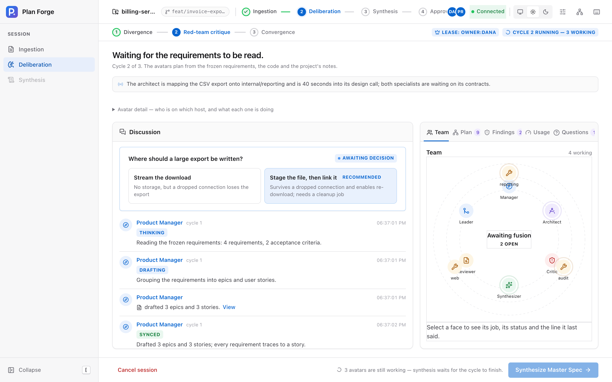
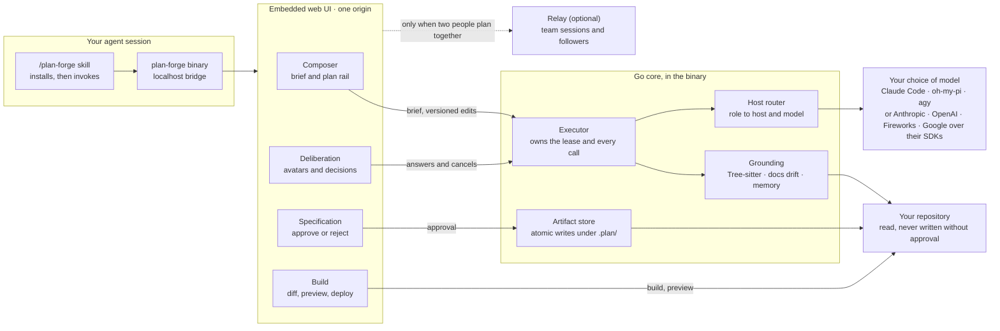
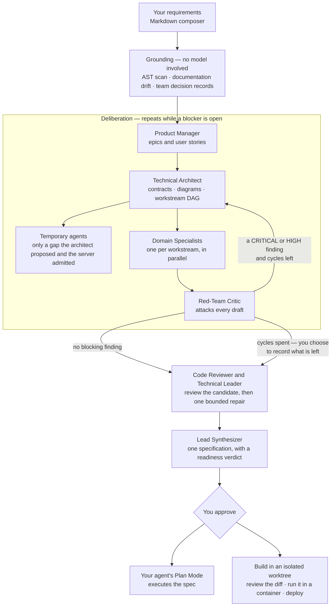

#  Agentic Plan Forge

[](https://github.com/danielckv/agentic-plan-forge/actions/workflows/ci.yml)
[](LICENSE)
[](https://github.com/danielckv/agentic-plan-forge/releases/latest)

**A deliberate planning gate for coding agents.** A coding agent asked to "add invoice export" will produce a plan
within seconds. That plan is plausible, and it is usually wrong: it trusts documentation that no longer matches the
code, forgets what the team decided last month, and lets a technical constraint decide a product question.

Plan Forge reads the repository first, then argues with itself about the plan, then gives you something you can approve.

It ships as one Go binary with an embedded web UI, and an optional relay for team sessions.



## Quickstart

```sh
curl -fsSL https://raw.githubusercontent.com/danielckv/agentic-plan-forge/main/scripts/install.sh | sh
```

Restart your agent, then type `/plan-forge`. You need Git, a browser, and a way to reach a model — either a coding
agent you are already signed in to (Claude Code, oh-my-pi) or an API key for Anthropic, OpenAI, Fireworks or Google,
which Setup asks for on a first run. `plan-forge run` opens the same workspace in a browser tab without an agent, and
`plan-forge config skills` lists what the coding agents on this machine already offer.

Both paths are first-class, and they are different credentials. A CLI host spends the subscription you already have;
an API key is billed to you and is faster, because there is no process to start per call and the prompt prefix is
cached between stages. There is no sign-in with a Claude or ChatGPT account: vendor terms reserve that for their own
applications, so a subscription is reached only by running their CLI. Keys you give Plan Forge are stored outside
`config.json`, shown only masked, and never passed through an agent — see
[docs/configuration.md](docs/configuration.md).

Re-running the command updates the binary and re-registers the skills. Windows, version pinning,
`plan-forge uninstall` and the full host matrix are in [docs/install.md](docs/install.md).

## How the parts connect

One process. No service to run unless you want a team relay.



Everything the window does reaches the same executor over one loopback bridge. The browser never calls a model itself.
An API key travels one way — you paste it into Setup, the binary writes it to a `0600` file, and every later read
returns a masked form, so a key cannot be lifted back out of the window or out of a screenshot of it.

## The flow

One brief goes in. Grounding is deterministic and finishes before any model runs. The avatars draft in cycles until the
critic has nothing left that is CRITICAL or HIGH; two reviewers then read the assembled candidate at once, a Technical
Leader integrates their findings, and one bounded repair pass answers the blocking ones. Then a specification is
compiled, for you to approve.

A run always ends with a plan. If the critic still has blocking findings when the cycle budget runs out, you are asked
once whether to take the plan with those findings recorded on it or to pause and revise — and if you take it, the
specification opens with a readiness verdict naming every one. The verdict is `ready`, `provisional` or `blocked`: a
blocked plan is refused rather than written, `provisional` lists every finding that was recorded instead of fixed, and
`ready` means every gate held. Only a blocker is worth another cycle; a MEDIUM finding
is offered to you as a tradeoff rather than spending a round of calls on it.



Nothing reaches a model until grounding is done, and nothing reaches you without the critic having had its say. A run
that stops gives every avatar a terminal state rather than leaving a card spinning, and a run that runs out of cycles
hands you a plan that is honest about what is still open rather than nothing at all.

## The avatars

Each avatar is a **fresh, tool-free model invocation** through the host agent CLI you already installed. No repository
access, no skills, no MCP servers, no inherited conversation. The evidence it may see is assembled by Plan Forge and
passed in as data, and a tripwire aborts the run if a tool call appears anyway.

They do not all see the same thing, and that is the point.

| Avatar | What it is given | What it produces |
| :--- | :--- | :--- |
| Product Manager | Nine product fields and nothing else | Epics, stories, acceptance criteria |
| Technical Architect | The code graph, contracts, recorded decisions | Interfaces, diagrams, a workstream DAG |
| Domain Specialists | Their own workstream and its evidence | Tasks with checks, in parallel |
| Red-Team Critic | Every draft, plus the evidence behind it | Findings, each with a severity |
| Code Reviewer | The assembled candidate and the repository | Findings about code claims: paths, symbols, "this passes" |
| Technical Leader | Both reviewers' findings | One resolution per finding, and the repair sections to fix |
| Lead Synthesizer | The reviewed drafts | One specification and manifest |

Two of those are permanent and new: the **Code Reviewer** reads the assembled candidate the way a reader of the diff
would, and the **Technical Leader** either closes each finding or directs one bounded repair. Neither can approve its
own work: the reviewer never drafts, and the leader's repair is re-checked by the deterministic validators.

**Temporary agents** exist for the expertise a brief needs and no workstream owns — a security boundary, a data
migration, an accessibility review. The architect may propose them in the same reply that carries its design; Plan
Forge verifies each one and admits at most `max_gap_agents` (default 2, ceiling 3, `0` disables and records every
proposal with its reason). An admitted agent drafts on its parent workstream's lane, cannot propose another agent, and
its deliverable either joins the plan or retires with a recorded reason. None of them becomes a settings entry.

Three deliberate asymmetries:

- **The Product Manager cannot see the code.** Product decisions stay product decisions instead of becoming
  consequences of an interface.
- **A specialist sees only its own workstream.** It cannot quietly re-plan the whole system.
- **The critic sees everything and owns nothing.** It has no draft to protect.

## A look inside

**Write the requirements.** One editor with headings, checklists and tables. Type `/` for a block, `@` to use the exact
name of a component in your code. The plan rail turns the text into epics as you write, each linked to the code it
touches.

**The plan refreshes itself while you write.** Not on every keystroke: nothing is read until the brief passes 100 words,
then at 30, 60 and 120 more words, always after you stop typing. Four reads carry a brief to a plan, and then it stops.
**Refresh plan** reads the document once, immediately, and switches the automatic path off so the two never race.

**See what it touches.** The Impact tab names the parts of your project the work affects and what happens to each:
changes, new, already there, or clashes with a decision the team recorded.

The demo GIF shows one brief from submission to the question drawer and the handoff, at 1× speed with no cuts:


The screenshot at the top of this page is the static alternative to the animation. Both come from the real UI driving a
seeded sample session, never from a live model run, so no credentials, personal paths or private repository details can
appear in them. `node web/scripts/preview.mjs` recaptures the frames and `scripts/demo-gif.sh` assembles the GIF, both
from the built bundle; CI publishes the same capture as the `promo-shots` artifact rather than committing over the
tracked files.

## Why

Agent plans tend to fail before implementation starts. A single-pass planner converges on the first plausible design,
trusts stale documentation, and mixes product requirements with low-level constraints. Plan Forge is slower and more
sceptical on purpose:

- **Requirements are separated from technical constraints,** so a product decision is not made by accident at the
  interface layer.
- **Grounding is deterministic and happens first.** Files are parsed into exported symbols, signatures and routes;
  documentation is checked against that graph, so a stale reference becomes a task instead of an assumption.
- **The team's own memory is read before anything is invented.** Decision records, specs, notes and recent commit
  subjects are matched against your requirements, bounded to 12 excerpts.
- **Every piece of evidence is bounded by count as well as size.** One measured run spent 13 of the architect's 15 calls
  writing a documentation chore per stale file. Lists are now cut, and the cut is stated in the payload, so a gap reads
  as unchecked rather than as nothing to do.

## After approval

**Build it in a worktree.** The agent implements the plan on its own branch under the Plan Forge cache, never in the
repository you are working in and never pushed to a remote. A Code tab shows the diff and what the agent did, step by
step. A Preview tab builds the worktree's Dockerfile and runs it on loopback.

**Or let a prepared VM do it.** With a sandbox provider configured, Plan Forge packages the exact revision in CI and runs
the project's own recorded build, test and run commands inside a managed VM, then serves an authenticated preview on
its own origin. The commands come from the repository's Makefile, package scripts and CI, not from a model at launch
time. A launch states the revision, the commands, the resources, the expiry and the cost before it happens. With no
provider configured, everything else still works and nothing is charged.

**Accept the exact implementation.** Approval of a plan and acceptance of its implementation are separate records. An
acceptance binds one head commit, one recipe and one bundle of evidence, and needs your sign-off plus a developer's
approval of that same commit from GitHub. A bot, the pull request's own author, a stale review or a degraded API never
counts.

## Also in the binary

**The question drawer.** When the avatars cannot decide something the owner must, the decision waits in a drawer on the
right of the workspace rather than blocking a modal over it: each card names the options, the tradeoff each carries, and
the one the model recommends as a hint rather than an answer. Brief ambiguities get their own classification buttons.
The drawer survives a page switch, and a rejected answer says why rather than looking like it worked.

**The component graph.** A graph button in the top bar opens the codebase as a flat diagram on any page: files and
folders, with the imports the scanner recorded between them. Selecting a node shows its path, language, declaration
count and neighbours; selecting it again centres the graph on it. The depth control chooses how many hops out to draw.

**Skills already on this machine.** Plan Forge reads the skill directories the installed coding agents actually read —
`~/.claude/skills`, `~/.omp/agent/skills`, `~/.agents/skills`, `~/.codex/skills` and the two Antigravity roots — and
shows each skill with the one-line description from its `SKILL.md`. `plan-forge config skills` prints the same list in
the terminal, `--json` for a script. The scan is shallow and read-only: one level below each named root, never a walk of
your home directory, and it never edits a foreign skill. At session start the hook adds one line naming what it found,
with no instruction to act on it.

**Checkpoint recovery.** An unfinished run is written to `docs/plans/.plan/run.json` after every validated draft, with
the PRD revision, the repository fingerprint, the context hash, the model slots, the validated outputs, the completed
work, the next action and the last error. The next run over the same baseline adopts those drafts instead of paying for
them twice; a changed brief, changed code or changed models invalidate the record, and the page says so.

**The handoff.** An approved plan compiles to a specification and a manifest with phases, dependency-ordered tasks and
executable verification commands. The handoff points a coding agent at that spec rather than at a flat task list.

## Documentation

| Guide | What it covers |
| :--- | :--- |
| [docs/install.md](docs/install.md) | Every host, Windows, version pinning, uninstall |
| [docs/usage.md](docs/usage.md) | The window, page by page |
| [docs/configuration.md](docs/configuration.md) | Hosts, models, `max_gap_agents`, storage, sandbox and repository settings |
| [docs/adrs/](docs/adrs/README.md) | Why each boundary sits where it does — indexed, with the threads worth following |
| [CONTRIBUTING.md](CONTRIBUTING.md) | Build, test and pull request workflow |

## Privacy and security

- Requirements, repository contents, project notes and absolute paths stay on your machine. There is no telemetry and
  no account.
- The window talks to a loopback bridge in the same process, which checks the request origin and a session token.
- An API key you give Plan Forge is written to `~/.plan-forge/credentials.json` with owner-only permissions,
  deliberately outside `config.json` because that file is quoted in `doctor` output and pasted into bug reports. It is
  never echoed by an endpoint, never written into a run receipt, and never logged; the window only ever receives a
  masked form. `plan-forge uninstall --purge` deletes it. A subscription used through a CLI host never reaches Plan
  Forge at all — that agent holds its own credentials.
- Nothing is written to your repository without an approval. Generated files never overwrite an existing document, and
  a decision-record number is never reused.
- A prepared VM receives a packaged archive, never a clone, and never your GitHub write token. The preview runs on a
  separate origin from the control UI.

## Project status

Plan Forge is **pre-1.0**. Releases are published on
[GitHub Releases](https://github.com/danielckv/agentic-plan-forge/releases) with client archives for macOS, Linux and
Windows, relay archives for Linux, and a multi-architecture relay image at `ghcr.io/danielckv/plan-forge-relay`.
Interfaces can still change between minor versions; see [CHANGELOG.md](CHANGELOG.md).

Next: signing and notarisation for macOS and Windows builds, a backlog so a second plan can start while the first is
being implemented, and Antigravity as a generation host once its CLI exposes an isolated-settings selector.

## Contributing

Contributions are welcome. Read [CONTRIBUTING.md](CONTRIBUTING.md) for the workflow, local checks and what a pull request
is expected to contain. This project follows the
[Contributor Covenant Code of Conduct](CODE_OF_CONDUCT.md). For help, see [SUPPORT.md](SUPPORT.md).

## License

Licensed under the [Apache License, Version 2.0](LICENSE).

Copyright 2026 Daniel Chernenkov
