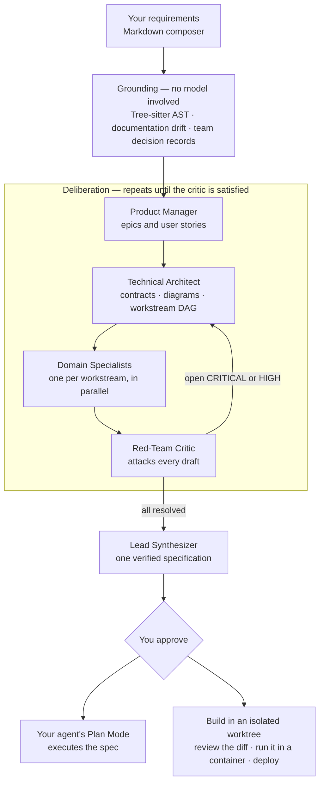

#  Agentic Plan Forge

[](https://github.com/danielckv/agentic-plan-forge/actions/workflows/ci.yml)
[](LICENSE)
[](https://github.com/danielckv/agentic-plan-forge/releases/latest)

**A blocking pre-planning gate for coding agents.** Instead of letting an agent jump from a brief straight to a linear
plan, Plan Forge deliberates first. You write what you want in a Markdown composer. Plan Forge reads the repository's
real code and the decisions your team already wrote down, runs a staged review by a team of avatars that argue with each
other, and returns a verified specification. From there the agent executes it — and, if you want, Plan Forge builds it
in an isolated worktree, runs it in a container and deploys it.

It ships as one Go binary with an embedded web UI, plus an optional relay server for team planning sessions.


## Quickstart

```sh
curl -fsSL https://github.com/danielckv/agentic-plan-forge/releases/latest/download/install.sh | sh
```

Restart your agent, then type `/plan-forge`. You need Git, a browser, and Claude Code or OMP signed in. The planning
window opens as a tab in your default browser when you run `/plan-forge`, and only then. Plan Forge never asks for or
stores provider API keys: it uses the credentials your host agent already has.

Re-run the same command to update; it replaces the binary and re-registers the skills, so there is nothing to force.
Windows, pinning a version, `plan-forge uninstall` and the full host matrix are in [docs/install.md](docs/install.md).

## The flow

One brief goes in. Grounding is deterministic and happens before any model runs. The avatars then argue in cycles until
the critic has nothing left that is CRITICAL or HIGH, and only then is a specification compiled for you to approve.



Nothing reaches a model until grounding is done, and nothing reaches you until the critic is out of blocking findings.
A run that stops gives every avatar a terminal state rather than leaving a card spinning.

## The avatars

Each avatar is a **fresh, tool-free model invocation** through the host agent CLI you already have installed. No
repository access, no skills, no MCP servers, no inherited conversation — the evidence it is allowed to see is assembled
by Plan Forge and passed in as data. A tripwire aborts the run if a tool call appears anyway.

They do not all see the same thing, and that is the point.

| Avatar | What it is given | What it produces | Model slot |
| :--- | :--- | :--- | :--- |
| **Product Manager** | Product requirements **only** — no file tree, no symbols, no code, no project notes | Epics and user stories, each an actor with a need, traced to a requirement | Main |
| **Technical Architect** | The PM's stories, the AST symbol graph, the documentation drift report | Interface contracts, Mermaid architecture and sequence diagrams, a workstream DAG, documentation-sync tasks | Main |
| **Domain Specialists** | The architect's contracts, plus its **own** workstream's module paths | Real file paths, function signatures and step-by-step execution logic for one subsystem | Main |
| **Red-Team Critic** | Every draft the architect and specialists wrote, and the AST to check them against | Severity-ranked critiques — `CRITICAL`, `HIGH`, `MEDIUM` — that force another cycle until resolved | **Judge** |
| **Lead Synthesizer** | Every resolved cycle | The final specification: Jira-style epics and subtasks, locked contracts, verification commands, dual effort estimates | Main |
| **Run Narrator** | Only the step reports the others emit | A plain-language account of what the run is doing right now. Gates nothing, and a failed narration costs a line and nothing else | Main |

Three deliberate asymmetries:

- **The Product Manager cannot see the code.** It receives nine product fields and nothing else, so product decisions
  are never made by code-level accident. A test enforces the exact payload shape.
- **The critic runs on a different model slot** than the authors, so a draft is not reviewed by the model that wrote it.
- **A specialist reads its own workstream first**, inside its own budget, rather than the whole repository — so the
  specialist planning billing is not paying for the reporting module's symbols.


## A look inside

**Write the requirements.** One large editor with headings, checklists and tables. Type `/` for blocks such as an epic
or a diagram, and `@` to use the exact name of a component in your code. On the right, the requirements become epic files
as you write, each linked to the code it touches.

**Know what the deliberation wants.** The Brief tab lists the five topics the avatars work from — who it is for, what
done looks like, why now, what is out of scope, what already exists — ticks each one your document mentions, and inserts
the heading for one it does not. It is an outline, not a gate: it never blocks Confirm, and it is a local word search
with no model call, so a tick means the topic is mentioned, not that it is answered.

**See what it touches.** The Impact tab names the parts of your project the work affects and what happens to each:
changes, new, already there, or clashes with a decision the team already recorded. One sentence apiece, in language that
does not assume you read code.


| Open an epic as a document | Browse the codebase while you write |
| :---: | :---: |
|  |  |

**Watch the avatars plan.** After you confirm, they work in the open: every status, draft, finding and decision lands in
one discussion, and the plan takes shape beside it. Each card names the host and model serving it, the part of the stage
in flight, and the evidence that call can see.

| Review the specification | Light or dark |
| :---: | :---: |
|  |  |

The screenshots come from the UI driving a seeded sample session (`web/scripts/promo.mjs`), not from a live model run.

## Why

Agent plans often fail before implementation starts. A single-pass planner converges on the first plausible design,
trusts documentation that no longer matches the code, forgets what the team decided last month, and mixes product
requirements with low-level technical constraints. Plan Forge inserts a deliberation step that is slower and more
sceptical on purpose:

- Requirements are separated from technical constraints, so product decisions are not made by code-level accident.
- Proposals are grounded in the repository's real structure, and documentation drift is reported instead of trusted.
- The avatars read the team's decision records, specs and notes, so a plan builds on earlier decisions instead of
  reopening them.
- Drafts are attacked by a dedicated critic that runs on a different model slot than the authors.
- The result is a contract-verified specification with explicit targets, verification commands and effort estimates.

## How it works

**Grounding is deterministic.** Files are parsed with Tree-sitter and reduced to exported symbols, signatures and route
registrations; documentation is cross-referenced against that graph so stale references become explicit documentation-sync
tasks instead of silent assumptions. Parse coverage gaps are reported as gaps, and structural matches are never treated
as proof that behaviour is complete.

**Every piece of evidence is bounded, by count as well as by size.** A byte budget alone does not bound the work a long
list causes: one measured run spent 13 of the architect's 15 calls writing a documentation chore per stale file. The
drift list is now cut to the 60 most useful items, and what was cut is always stated in the payload, so the model treats
a gap as unchecked rather than as nothing to do.

**The repository's own memory is read first.** Before the avatars start, Plan Forge gathers decision records, specs,
notes and recent commit subjects, matched against your requirements and bounded to 12 excerpts. The Impact tab then asks
the model which of those parts the requirements actually affect — it answers by picking from a numbered shortlist rather
than writing paths, so every file it names exists. That map is for you; the avatars never receive it.

**Effort is estimated twice** from the same task graph: a human schedule based on a 9-hour productive day, and an agent
schedule based on declared parallelism. Estimates are labelled as estimates unless they come from recorded runs.

**After approval, Plan Forge can build it.** The agent implements the plan in a git worktree under the Plan Forge cache,
on its own branch — never in the repository you are working in, and never to a remote, so you merge it yourself. A Code
tab shows the diff and what the agent did step by step; a Preview tab builds the worktree's Dockerfile and runs it on
loopback, sandboxed. Deploy publishes that same image to an Agent Box sandbox or your local Docker daemon. Choosing
"Don't deploy" keeps the original behaviour, where the tab closes shortly after approval.

**Setup says what your installation can actually do.** Hosts are listed with whether they can serve a call — not merely
whether they are signed in, which is a different question and has silently cost whole runs — alongside the tools each
feature needs, the installed skills and the managed hooks.

The whole flow, page by page, is in [docs/usage.md](docs/usage.md).

## Documentation

| Guide | What it covers |
| :--- | :--- |
| [Install](docs/install.md) | Requirements, one-command and manual install, what gets written per host, hooks, update and uninstall |
| [Usage](docs/usage.md) | The composer, the Brief outline, the avatar room, the specification, build and deploy, Plan Mode handoff |
| [Configuration](docs/configuration.md) | Hosts, models, workday baseline, deploy targets and self-hosting the relay |
| [Decision records](docs/adrs/) | Why each design choice was made, what it cost, and what is still unmeasured |
| [Requirements catalogue](docs/requirements/) | Owners, acceptance criteria and traceability for every requirement |
| [Follow-ups](FOLLOW_UPS.md) | Known gaps, with their causes and what "done" would mean |
| [Contributing](CONTRIBUTING.md) | Repository layout, development workflow and the full local check suite |

## Privacy and security

- Requirements documents, repository contents, project notes and absolute paths stay on your machine unless you
  explicitly start a remote session. The relay receives session state: the shared document, avatar summaries and drafts,
  critiques, decisions and the approved plan.
- Plan Forge does not scan, redact or block what you write. Your text goes to your own agent CLI, exactly as it would in
  a chat with that agent. See [ADR 0003](docs/adrs/0003-no-text-scanning-in-composer.md).
- Avatar invocations are tool-free. Every generation runs with repository access, skills and MCP servers disabled, and a
  tripwire aborts a run if a tool call appears anyway. The coding run after approval is the one exception, and it is
  confined to a worktree outside your repository.
- A relay never accepts requests from a browser, requires TLS off loopback, and stores only hashes of credentials.
- Security reports are welcome, and should not be filed as public issues. See [SECURITY.md](SECURITY.md).

## Project status

Plan Forge is **pre-1.0**. Releases are published on
[GitHub Releases](https://github.com/danielckv/agentic-plan-forge/releases) with client archives for macOS, Linux and
Windows, relay archives for Linux, and a multi-architecture relay image at `ghcr.io/danielckv/plan-forge-relay`.
Interfaces can still change between minor versions; see [CHANGELOG.md](CHANGELOG.md).

Next on the roadmap: signing and notarisation for macOS and Windows builds, a verification gate that runs the plan's own
commands after a coding run, and Antigravity as a generation host once its CLI exposes an isolated-settings selector.

## Contributing

Contributions are welcome. Please read [CONTRIBUTING.md](CONTRIBUTING.md) for the development workflow, local checks and
pull request expectations. This project follows the
[Contributor Covenant Code of Conduct](CODE_OF_CONDUCT.md). For help, see [SUPPORT.md](SUPPORT.md).

## License

Licensed under the [Apache License, Version 2.0](LICENSE).

Copyright 2026 Daniel Chernenkov
