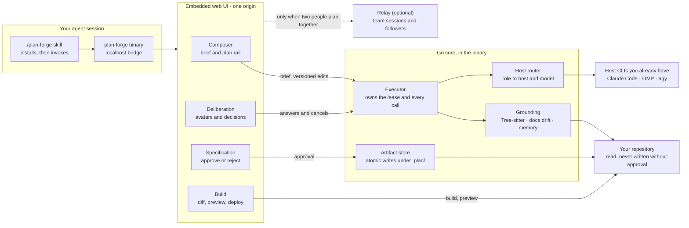
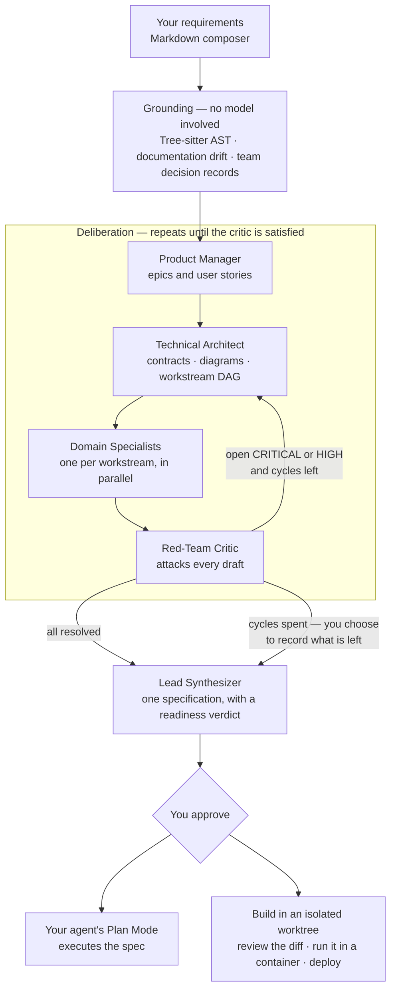

#  Agentic Plan Forge

[](https://github.com/danielckv/agentic-plan-forge/actions/workflows/ci.yml)
[](LICENSE)
[](https://github.com/danielckv/agentic-plan-forge/releases/latest)

**A deliberate planning gate for coding agents.** A coding agent asked to "add invoice export" will produce a plan
within seconds. That plan is plausible, and it is usually wrong: it trusts documentation that no longer matches the
code, forgets what the team decided last month, and lets a technical constraint decide a product question.

Plan Forge reads the repository first, then argues with itself about the plan, then gives you something you can approve.

It ships as one Go binary with an embedded web UI, and an optional relay for team sessions.


## Quickstart

```sh
curl -fsSL https://raw.githubusercontent.com/danielckv/agentic-plan-forge/main/scripts/install.sh | sh
```

Restart your agent, then type `/plan-forge`. You need Git, a browser, and Claude Code or OMP signed in. Plan Forge
never asks for or stores provider API keys: it uses the credentials your host agent already has.

Re-running the command updates the binary and re-registers the skills. Windows, version pinning,
`plan-forge uninstall` and the full host matrix are in [docs/install.md](docs/install.md).

## How the parts connect

One process. No service to run unless you want a team relay.



Everything the window does reaches the same executor over one loopback bridge. The browser never holds provider
credentials and never calls a model itself.

## The flow

One brief goes in. Grounding is deterministic and finishes before any model runs. The avatars argue in cycles until the
critic has nothing left that is CRITICAL or HIGH. Then a specification is compiled, for you to approve.

A run always ends with a plan. If the critic still has blocking findings when the cycle budget runs out, you are asked
once whether to take the plan with those findings recorded on it or to pause and revise — and if you take it, the
specification opens with a readiness verdict naming every one. Only a blocker is worth another cycle; a MEDIUM finding
is offered to you as a tradeoff rather than spending a round of calls on it.



Nothing reaches a model until grounding is done, and nothing reaches you without the critic having had its say. A run
that stops gives every avatar a terminal state rather than leaving a card spinning, and a run that runs out of cycles
hands you a plan that is honest about what is still open rather than nothing at all.

## The avatars

Each avatar is a **fresh, tool-free model invocation** through the host agent CLI you already installed. No repository
access, no skills, no MCP servers, no inherited conversation. The evidence it may see is assembled by Plan Forge and
passed in as data, and a tripwire aborts the run if a tool call appears anyway.

They do not all see the same thing, and that is the point.

| Avatar | What it is given | What it produces |
| :--- | :--- | :--- |
| Product Manager | Nine product fields and nothing else | Epics, stories, acceptance criteria |
| Technical Architect | The code graph, contracts, recorded decisions | Interfaces, diagrams, a workstream DAG |
| Domain Specialists | Their own workstream and its evidence | Tasks with checks, in parallel |
| Red-Team Critic | Every draft, plus the evidence behind it | Findings, each with a severity |
| Lead Synthesizer | The resolved drafts | One specification and manifest |

Three deliberate asymmetries:

- **The Product Manager cannot see the code.** Product decisions stay product decisions instead of becoming
  consequences of an interface.
- **A specialist sees only its own workstream.** It cannot quietly re-plan the whole system.
- **The critic sees everything and owns nothing.** It has no draft to protect.


## A look inside

**Write the requirements.** One editor with headings, checklists and tables. Type `/` for a block, `@` to use the exact
name of a component in your code. The plan rail turns the text into epics as you write, each linked to the code it
touches.

**The plan refreshes itself while you write.** Not on every keystroke: nothing is read until the brief passes 100 words,
then at 30, 60 and 120 more words, always after you stop typing. Four reads carry a brief to a plan, and then it stops.
**Refresh plan** reads the document once, immediately, and switches the automatic path off so the two never race.

**See what it touches.** The Impact tab names the parts of your project the work affects and what happens to each:
changes, new, already there, or clashes with a decision the team recorded.


| Open an epic as a document | Browse the codebase while you write |
| :---: | :---: |
|  |  |

**Watch them plan.** Every status, draft, finding and decision lands in one discussion, and the plan takes shape beside
it. Each card names the host and model serving it, the part of the stage in flight, and the evidence that call can see.

| Review the specification | Light or dark |
| :---: | :---: |
|  |  |

The screenshots are captured from the real UI driving a seeded sample session, not from a live model run. CI rebuilds
them on every change (`promo-shots` job in [.github/workflows/ci.yml](.github/workflows/ci.yml)).

## Why

Agent plans tend to fail before implementation starts. A single-pass planner converges on the first plausible design,
trusts stale documentation, and mixes product requirements with low-level constraints. Plan Forge is slower and more
sceptical on purpose:

- **Requirements are separated from technical constraints,** so a product decision is not made by accident at the
  interface layer.
- **Grounding is deterministic and happens first.** Files are parsed into exported symbols, signatures and routes;
  documentation is checked against that graph, so a stale reference becomes a task instead of an assumption.
- **The team's own memory is read before anything is invented.** Decision records, specs, notes and recent commit
  subjects are matched against your requirements, bounded to 12 excerpts.
- **Every piece of evidence is bounded by count as well as size.** One measured run spent 13 of the architect's 15 calls
  writing a documentation chore per stale file. Lists are now cut, and the cut is stated in the payload, so a gap reads
  as unchecked rather than as nothing to do.

## After approval

**Build it in a worktree.** The agent implements the plan on its own branch under the Plan Forge cache, never in the
repository you are working in and never pushed to a remote. A Code tab shows the diff and what the agent did, step by
step. A Preview tab builds the worktree's Dockerfile and runs it on loopback.

**Or let a prepared VM do it.** With a sandbox provider configured, Plan Forge packages the exact revision in CI and runs
the project's own recorded build, test and run commands inside a managed VM, then serves an authenticated preview on
its own origin. The commands come from the repository's Makefile, package scripts and CI, not from a model at launch
time. A launch states the revision, the commands, the resources, the expiry and the cost before it happens. With no
provider configured, everything else still works and nothing is charged.

**Accept the exact implementation.** Approval of a plan and acceptance of its implementation are separate records. An
acceptance binds one head commit, one recipe and one bundle of evidence, and needs your sign-off plus a developer's
approval of that same commit from GitHub. A bot, the pull request's own author, a stale review or a degraded API never
counts.

## Documentation

| Guide | What it covers |
| :--- | :--- |
| [docs/install.md](docs/install.md) | Every host, Windows, version pinning, uninstall |
| [docs/usage.md](docs/usage.md) | The window, page by page |
| [docs/configuration.md](docs/configuration.md) | Hosts, models, storage, sandbox and repository settings |
| [docs/adrs/](docs/adrs/) | Why each boundary sits where it does |
| [CONTRIBUTING.md](CONTRIBUTING.md) | Build, test and pull request workflow |

## Privacy and security

- Requirements, repository contents, project notes and absolute paths stay on your machine. There is no telemetry and
  no account.
- The window talks to a loopback bridge in the same process. Provider credentials never reach the browser.
- Nothing is written to your repository without an approval. Generated files never overwrite an existing document, and
  a decision-record number is never reused.
- A prepared VM receives a packaged archive, never a clone, and never your GitHub write token. The preview runs on a
  separate origin from the control UI.

## Project status

Plan Forge is **pre-1.0**. Releases are published on
[GitHub Releases](https://github.com/danielckv/agentic-plan-forge/releases) with client archives for macOS, Linux and
Windows, relay archives for Linux, and a multi-architecture relay image at `ghcr.io/danielckv/plan-forge-relay`.
Interfaces can still change between minor versions; see [CHANGELOG.md](CHANGELOG.md).

Next: signing and notarisation for macOS and Windows builds, a backlog so a second plan can start while the first is
being implemented, and Antigravity as a generation host once its CLI exposes an isolated-settings selector.

## Contributing

Contributions are welcome. Read [CONTRIBUTING.md](CONTRIBUTING.md) for the workflow, local checks and what a pull request
is expected to contain. This project follows the
[Contributor Covenant Code of Conduct](CODE_OF_CONDUCT.md). For help, see [SUPPORT.md](SUPPORT.md).

## License

Licensed under the [Apache License, Version 2.0](LICENSE).

Copyright 2026 Daniel Chernenkov
