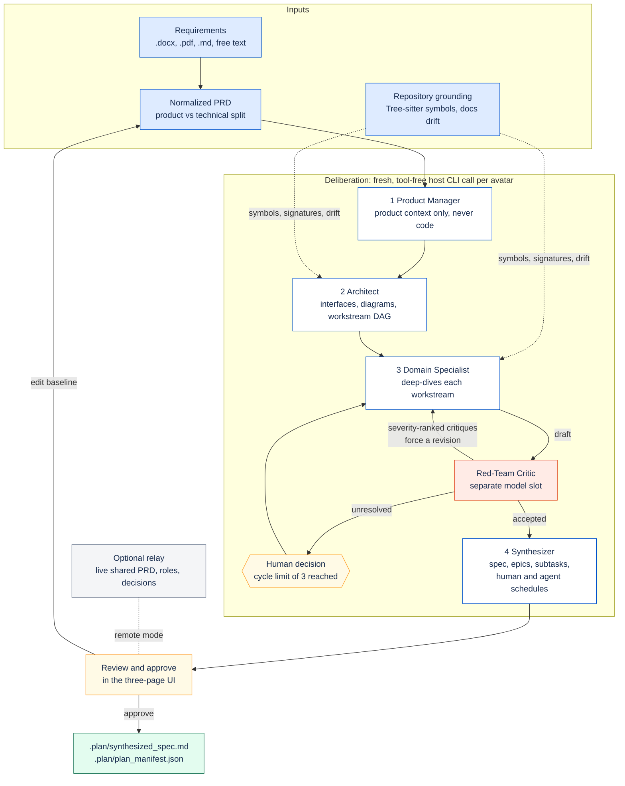

#  Agentic Plan Forge

[](https://github.com/danielckv/agentic-plan-forge/actions/workflows/ci.yml)
[](LICENSE)
[](https://github.com/danielckv/agentic-plan-forge/releases/latest)

Agentic Plan Forge is a blocking pre-planning gate for coding agents. Instead of letting an agent jump from a brief
straight to a linear plan, it deliberates first: it reads your requirements documents, scans the repository's actual
symbols, runs a staged multi-avatar review, and returns a verified specification that the agent then executes.

It ships as one Go binary with an embedded web UI, plus an optional relay server for team planning sessions.


## Status

The project is **pre-1.0**. Releases are published on [GitHub Releases](https://github.com/danielckv/agentic-plan-forge/releases)
with client archives for macOS, Linux and Windows, relay archives for Linux, and a multi-architecture relay image at
`ghcr.io/danielckv/plan-forge-relay`. Interfaces can still change between minor versions; see [CHANGELOG.md](CHANGELOG.md).

## Why

Agent plans often fail before implementation starts. A single-pass planner converges on the first plausible design,
trusts documentation that no longer matches the code, and mixes product requirements together with low-level technical
constraints. Plan Forge inserts a deliberation step that is deliberately slower and more sceptical:

- Requirements are separated from technical constraints, so product decisions are not made by code-level accident.
- Proposals are grounded in the repository's real structure, and documentation drift is reported instead of trusted.
- Drafts are attacked by a dedicated critic that runs on a different model slot than the authors.
- The result is a contract-verified specification with explicit targets, verification commands and effort estimates.

## How it works



Each avatar runs as a fresh, tool-free model invocation through the host agent CLI you already have installed and
authenticated. The Product Manager receives product requirements only: no file trees, no symbol graphs, no code. The
Red-Team Critic runs on a separate model slot so it does not simply agree with its own drafting.

Repository grounding is deterministic. Files are parsed with Tree-sitter and reduced to exported symbols, signatures and
route registrations; documentation is cross-referenced against that graph so stale references become explicit
documentation-sync tasks instead of silent assumptions. Parse coverage gaps are reported as gaps, and structural matches
are never treated as proof that behaviour is complete.

Effort is estimated twice from the same task graph: a human schedule based on a 9-hour productive day, and an agent
schedule based on declared parallelism. Estimates are labelled as estimates unless they come from recorded runs.

## Requirements

| Requirement | Notes |
| :--- | :--- |
| Git | Plan Forge grounds on a repository. Non-Git folders work with reduced status features. |
| Chromium-family browser | Chrome, Edge, Brave or Chromium. The UI opens in a dedicated application window, never a browser tab. |
| Claude Code or OMP, signed in | Avatar generation runs through these CLIs. |
| Antigravity (optional) | Hosts `/plan-forge` and `/plan-config` as skills. With only Antigravity installed, avatar generation reports that Claude Code or OMP is required. |
| Poppler and Tesseract (optional) | Only needed to read scanned PDFs. Text from born-digital PDFs needs nothing extra. |

Plan Forge never asks for or stores provider API keys. It uses the credentials and configuration your host agent already
has.

The table above lists runtime prerequisites. The project's own requirements catalogue and the audit of the master plan live in `docs/requirements/`.
The catalogue carries the owner, the acceptance criteria and the traceability for every requirement.

## Install

### One command

macOS and Linux, installing the binary and registering the skills in every detected local agent:

```sh
curl -fsSL https://github.com/danielckv/agentic-plan-forge/releases/latest/download/install.sh | sh
```

Windows (PowerShell 5.1 or later):

```powershell
[Net.ServicePointManager]::SecurityProtocol = [Net.SecurityProtocolType]::Tls12; irm https://github.com/danielckv/agentic-plan-forge/releases/latest/download/install.ps1 | iex
```

Restart your agent afterwards, then type `/plan-forge`. Restarting matters because agents scan their skill directories at
start-up. If the install directory is not on your `PATH`, the installer prints the exact line to add.

The one-command install fetches the latest published release, `v0.1.2` or later. Every feature in this README, including the plan-mode handoff, `plan-forge validate`, the board, the coordinator and the Graph view, ships in `v0.1.2`. Earlier releases did not: `v0.1.1` still had the blank-window and handshake failures that `v0.1.2` fixes. [Build from source](#build-from-source) remains the path for unreleased changes.

### What gets installed

The installer verifies the release checksum, places the binary, then runs `plan-forge install --host auto`, which detects
installed agents and writes the skills, commands and hooks:

| Host | Installed files | Slash commands |
| :--- | :--- | :--- |
| Claude Code | `~/.claude/skills/plan-forge/SKILL.md`, `~/.claude/skills/plan-config/SKILL.md` and `~/.claude/skills/plan-forge-board/SKILL.md` | `/plan-forge`, `/plan-config`, `/plan-forge-board` |
| OMP | `~/.omp/agent/commands/plan-config.md` and the hook `~/.omp/agent/hooks/pre/plan-forge.ts`, which registers `/plan-forge` and `/plan-forge-board`. No skill files | `/plan-forge`, `/plan-config`, `/plan-forge-board` |
| Antigravity | `~/.gemini/antigravity-cli/skills/{plan-forge,plan-config}/SKILL.md` and `~/.gemini/config/skills/{plan-forge,plan-config}/SKILL.md` | `/plan-forge`, `/plan-config` |

Every row above ships in `v0.1.2` and later. `v0.1.1` installed none of the `plan-forge-board` artifacts or the board hook entries.

**OMP installs no skills.** oh-my-pi reaches Plan Forge through built-in commands only: the hook registers `/plan-forge` and `/plan-forge-board` with `pi.registerCommand`, and `/plan-config` is `~/.omp/agent/commands/plan-config.md`. Because no `SKILL.md` is written for oh-my-pi, a command can never be listed twice. Upgrading removes the `plan-forge` and `plan-config` skill copies an earlier version installed, and leaves a copy you edited yourself untouched.

Plan Forge still marks the Claude copies `enabled: false`, which oh-my-pi's skill scanners skip. That marker now carries the whole guarantee on its own: oh-my-pi reads `<repo>/.claude/skills` by default and `~/.claude/skills` on opt-in, and an unmarked copy would surface the Claude-rendered body — whose plan-mode step calls `EnterPlanMode`, a tool oh-my-pi does not have — beside the command the hook registers. Claude Code ignores the key. `plan-forge doctor` lists the roots each host reads and flags any skill that would shadow a built-in command, and `plan-forge install` prints the same warning; suppress it with `ignoredSkills: ["plan-forge*"]` or by removing the foreign provider from `enabledProviders` (Plan Forge never edits your settings).

One trade comes with this: a skill can be matched from its description, a registered command cannot. Asking oh-my-pi in prose to "forge a plan" no longer triggers Plan Forge on its own — type `/plan-forge`.

Hooks are registered where the host supports them:

- Claude Code: `SessionStart` carries two handlers — one reports a plan that changed since your last session, the
  other makes sure the command center is running and opens a tab. `PostToolUse` (matcher
  `Bash|Edit|Write|MultiEdit|NotebookEdit`) moves the agent
  into Plan Mode after an approval and reports the tool call. `PreToolUse` (matcher `Edit|Write|MultiEdit|NotebookEdit`)
  refuses an edit once when the approved plan changed under a running session, and refuses an edit aimed at the approved
  plan itself. `PostToolUse` and `UserPromptSubmit` deliver board edits.
  Every entry in `~/.claude/settings.json` carries a `plan-forge managed` marker, and uninstall removes only those.

  The guard blocks at most once per change: it records what the session was told, denies once when that changes, and
  immediately records the new state, so your next tool call proceeds. It never blocks in a repository with no approved
  plan, and it never runs a repository scan — it reads two files. `Bash` is deliberately outside the matcher, because
  blocking it would block the `plan-forge validate` run the refusal asks for.
- OMP: the hook reports plan status at session start, opens the command center beside it, runs the forge from
  `/plan-forge`, opens the board from `/plan-forge-board`, reports tool calls, and pushes board edits into the live
  session.
- Antigravity: user-scope installs merge a `SessionStart` plan-status entry, carrying the same `plan-forge managed` marker, into `~/.gemini/config/hooks.json`; whether Antigravity loads that layout is unverified.

Project-scope installs (`--scope project`) write into the repository instead and are opt-in, because those directories
are usually machine-local and should not be committed.

Installation is idempotent: re-running it skips unchanged files, refuses to overwrite files it does not own, and keeps a
manifest so removal is exact.

### Manual binary install

1. Download `plan-forge-<os>-<arch>.tar.gz` (Windows: `.zip`) and `checksums.txt` from the [releases page](https://github.com/danielckv/agentic-plan-forge/releases).
2. Verify the download with `shasum -a 256 -c checksums.txt --ignore-missing` on macOS and Linux, or `Get-FileHash -Algorithm SHA256` on Windows.
3. Extract the archive and move `plan-forge` onto your `PATH`.
4. Run `plan-forge install` to register the skills.

### Verify

```sh
plan-forge version
plan-forge doctor
```

`doctor` reports which agents were found, whether each is authenticated, which models are available, and whether the
browser and optional OCR tools are present. It redacts secrets and prints no paths beyond the skill directories it
manages.

### Update

Re-run the same install command. Skills and hooks are refreshed with the current absolute binary path.

### Uninstall

```sh
plan-forge uninstall --host all
```

This removes only files and hook entries that Plan Forge installed, restoring any settings file it modified. Add
`--purge` to also delete Plan Forge's own configuration, credentials, backups and caches. It refuses if the state
directory lacks Plan Forge's marker file, so it cannot delete a directory it does not own. Repository `.plan/` folders
are never touched.

### Build from source

Contributors need Go, Node.js and a C toolchain, because the Tree-sitter runtime links C grammars:

```sh
npm --prefix web ci
npm --prefix web run build
CGO_ENABLED=1 go build -tags client -o plan-forge ./cmd/client
```

`go install` is not a supported end-user path for the same reason: it requires a local C toolchain.

## Use

Type `/plan-forge` in your agent. The skill starts the app window and waits, so the agent's terminal stays blocked until
you approve a plan.

The UI has three sequential views, with a phase stepper, a collapsible sidebar (`[`), a System/Light/Dark theme switch
and a shortcut sheet (`?`):

1. **Ingestion.** Add `.docx`, `.pdf` or `.md` files, or paste text. Status pills show the repository scan and the
  documentation health check. The interpretation is editable Markdown, shared live with any collaborators.
2. **Deliberation.** Avatar cards show each role's status, public progress summaries, drafts, diagrams and critiques.
  Cross-avatar conflicts are highlighted, and trade-offs that need judgement become A/B decision cards instead of silent
  choices by a model.
3. **Synthesis.** A Confluence-style specification with diagrams, Jira-style epics and subtasks, documentation-sync tasks
  and the two effort schedules. The table of contents follows your scroll. The task matrix can be filtered by ID, title
  or target file. Diagrams expand to full screen.

### Plan Mode handoff and validation

*Ships in `v0.1.2` and later; `v0.1.1` has neither the handoff nor `plan-forge validate`.*

Approving writes the plan, and the window shows each handoff step before it closes.

1. `plan-forge wait` returns the approval with a `validation` result. The validation checks that the plan is approved on this machine, that it has not drifted from the repository, and how many AST targets already exist.
2. The agent enters Plan Mode with the specification as the source of truth.
3. The agent reviews the validation, verifies the targets, and presents the execution checklist for your approval.

How each host enters Plan Mode:

- **Claude Code** calls `EnterPlanMode`, enforced by the managed `PostToolUse` hook.
- **OMP** `/plan-forge` opens a new plan-mode session seeded with the spec and the validation result. If the session API is unavailable, the hook prefills `/plan …` and you press Enter.
- **Antigravity** asks you to switch modes.

You can re-run the check at any time:

```sh
plan-forge validate            # exit 0 valid, 6 invalid
plan-forge validate --json
```

### Command center

*Ships after `v0.1.3`.*

Starting `claude` or `omp` opens `http://127.0.0.1:8420` in your browser, once. It is a browser tab, not the dedicated
window the forge and board use, and it outlives any one session.

- **Live** shows every running harness — Claude Code and OMP, across repositories — with its branch, the tool it just
  ran and the files it has touched. **It works with no plan at all.** The board needs an approved manifest and refuses
  to exist without one; this records a session from the moment a harness starts, on any branch, planned or not.
- When a repository does have an approved plan, Live leads with the coordinator's verdict: **Active now** and **Begin
  next**, the same ranking the board window computes, so the task to start is stated rather than inferred. Accepting a
  discovery re-ranks it. Nothing enters the plan automatically, and the approved manifest is never modified.
- **Sprint** renders the approved plan as epic, story and task, with live columns.
- **Setup** explains the local surface. There is nothing to connect: see below.

The daemon hands each tab a single-use launch ticket, so a tab you open by hand parks on a screen telling you to run
`plan-forge center ensure --open` rather than being handed a session. A tab is opened only when none is already
connected, and a cooldown stops several terminals starting at once from opening several tabs. Control it with
`center_port` and `center_auto_open` in the config, or `PLAN_FORGE_CENTER_PORT`.

```sh
plan-forge center status          # is it running, and where
plan-forge center ensure --open   # start it and open one tab
plan-forge center serve           # run it in the foreground
```

**No trackers, no egress.** The command center binds loopback only and makes no outbound request. It connects to no
issue tracker and stores no credentials: the plan, the board and the live sessions are local state. An end-to-end test
asserts the page issues zero external requests.

### Plan board

*Ships in `v0.1.2` and later; `v0.1.1` has no `/plan-forge-board`, board or Graph view.*

Type `/plan-forge-board` in Claude Code or OMP after a plan is approved. The Plan-Forge window opens on a live board.

- Tasks are laid out as To do, In progress, Done and Drifted, from evidence in the code. Cards move as the agent works.
- Each task can be set to High, Normal or Low priority, and can carry context notes for the agent.
- Edits reach the running agent through its own APIs. OMP receives them pushed into the session. Claude Code receives
  them as hook context at its next step.
- The approved manifest is never modified. Edits live in a machine-local overlay in the Plan-Forge cache.
- The board header has a `Board | Graph` switch. The Graph view draws the plan as task nodes with dependency edges,
  colored by live state; tasks the plan did not contain use a dashed style.
- A coordinator moves cards in real time from what the agent actually does — file edits and `board report` calls —
  not only from the periodic AST scan. Verification receipts count as plan evidence through that periodic evidence
  scan; nothing records them on the board directly. A coordinator panel on the right lists Active now and Up next.
- The Graph also shows discovered items: tasks and repository paths the agent touched that no planned target covers.
  Each stays proposed until you accept or dismiss it; nothing enters the plan automatically.
- Host capture is automatic: the Claude `PostToolUse` hook covers `Bash|Edit|Write|MultiEdit|NotebookEdit`, and the
  OMP hook covers its edit/write tools.

`plan-forge board pull --repo . --consumer claude:<id> --format text` prints the edits a consumer has not seen yet.

### Solo and remote

Solo mode keeps everything local. In remote mode, teammates install the client and join a session with an invite, and the
relay mirrors session state so everyone sees the same document, drafts and decisions. Only the host machine runs the model
pipeline, so a run is never billed twice. Approving a plan never stages, commits or pushes anything: your Git history
stays under your control.

### Configuration

```sh
plan-forge config --show
```

Sets the relay URL, the main and critic host/model pair, and the human workday baseline used for estimates. Relay
credentials can only be set from your own terminal (`plan-forge config --set-relay-token`), never through an agent skill.

### Self-host the relay on Cloud Run

Run your own relay as a Cloud Run service instead of the public one. The deploy script builds the image with Cloud
Build, stores the token in Secret Manager, and deploys with the proxy and WebSocket settings the relay expects:

```sh
./scripts/deploy-relay-cloudrun.sh --project my-project
```

Then point your client at the printed URL. Full reference: [docs/deploy/relay-cloud-run.md](docs/deploy/relay-cloud-run.md).

## Privacy and security

- Requirements documents, repository contents and absolute paths stay on your machine unless you explicitly start a remote
  session. The relay receives session state: the shared document, avatar summaries and drafts, critiques, decisions and
  the approved plan.
- Avatar invocations are tool-free. Every generation runs with repository access, skills and MCP servers disabled, and a
  tripwire aborts a run if a tool call appears anyway.
- A relay never accepts requests from a browser, requires TLS off loopback, and stores only hashes of credentials.
- Security reports are welcome. See [SECURITY.md](SECURITY.md).

## Repository layout

```text
cmd/client, cmd/relay       entrypoints, separated by build tags
internal/contracts          shared data shapes, schemas and error codes
internal/ingestion          document parsing and PRD normalization
internal/ast                Tree-sitter grounding and documentation drift
internal/host               agent CLI adapters and skill installation
internal/avatars            staged deliberation and prompt contracts
internal/synthesizer        specification, manifest and effort schedules
internal/session, collab    authoritative state and shared-document editing
internal/relay              protocol, hub and local bridge
web                         embedded React UI
integrations                skill, command and hook templates
```

## Local development checks

Run from the repository root:

```sh
# Go: shared packages, relay (server tag) and client (client tag; needs CGO and a built web/dist)
go test ./...
go test -tags server ./cmd/relay/... ./internal/relay/...
npm --prefix web ci && npm --prefix web run build
go test -tags client ./...

# Web
npm --prefix web run typecheck
npm --prefix web test

# Scripts, docs and workflows
bash tests/deploy/cloudrun_test.sh
npx --yes markdownlint-cli2 "**/*.md"
actionlint
npx --yes editorconfig-checker
lychee --no-progress --config lychee.toml "**/*.md"
```

[CONTRIBUTING.md](CONTRIBUTING.md) is the single source of truth for the workflow.

## Roadmap

- Shipped in `v0.1.x`: client with embedded UI, document ingestion, Tree-sitter grounding, staged avatars,
  specification compiler, relay server for remote sessions, one-command install and skill registration, and a Cloud
  Run deployment script for the relay.
- Next: signing and notarisation for macOS and Windows builds, and Antigravity as a generation host once its CLI
  exposes an isolated-settings selector.

## Contributing

Contributions are welcome. Please read [CONTRIBUTING.md](CONTRIBUTING.md) for the development workflow, local checks and
pull request expectations.

## Code of Conduct

This project follows the [Contributor Covenant Code of Conduct](CODE_OF_CONDUCT.md). By participating, you are expected to
uphold it.

## Security

Please see [SECURITY.md](SECURITY.md) for how to report vulnerabilities. Do not open public issues for security reports.

## Support

Please see [SUPPORT.md](SUPPORT.md) for how to get help with this project.

## License

Licensed under the [Apache License, Version 2.0](LICENSE).

Copyright 2026 Daniel Chernenkov
