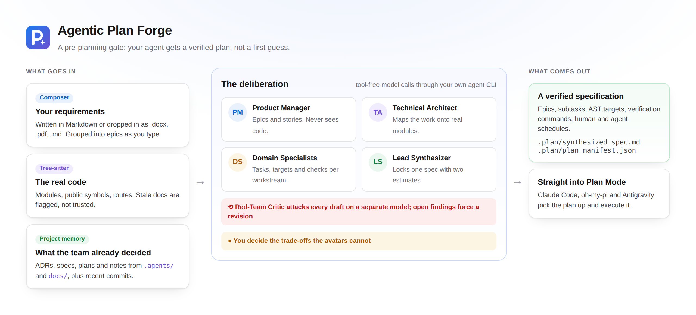
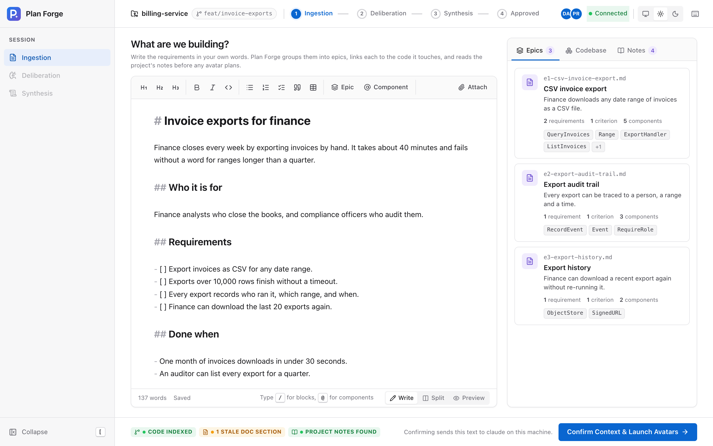
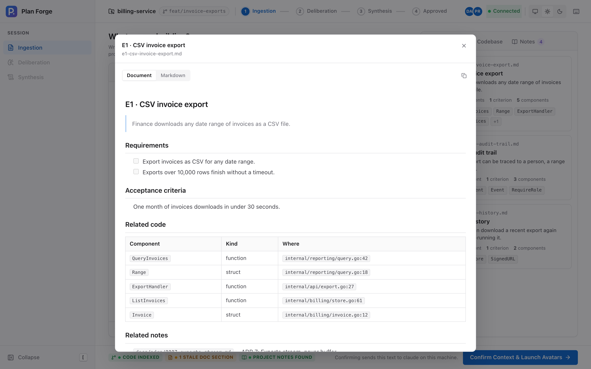
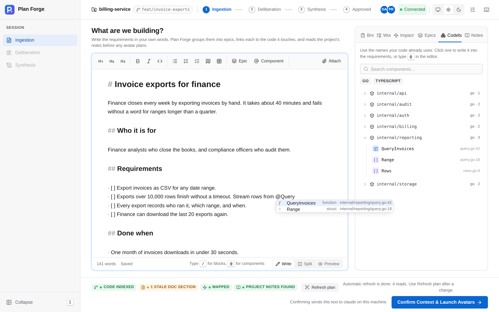
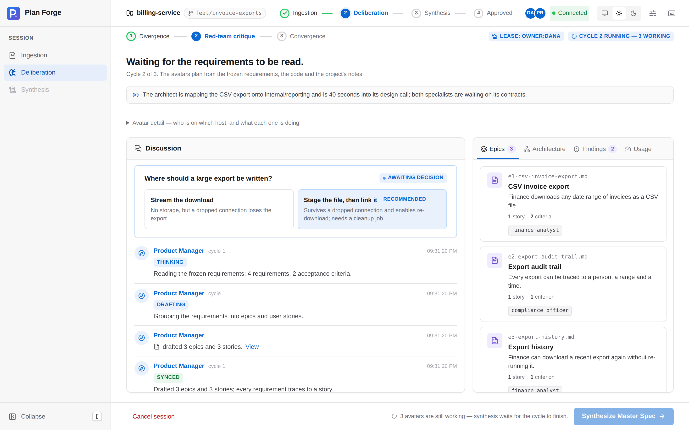
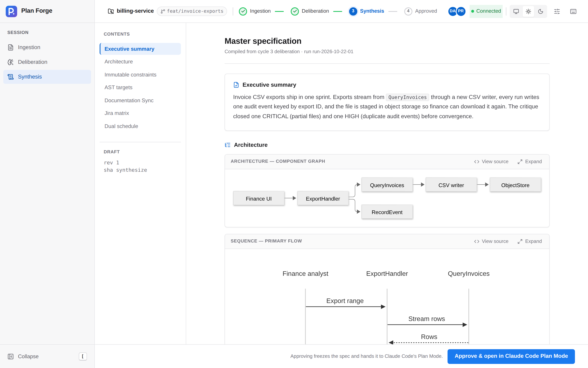
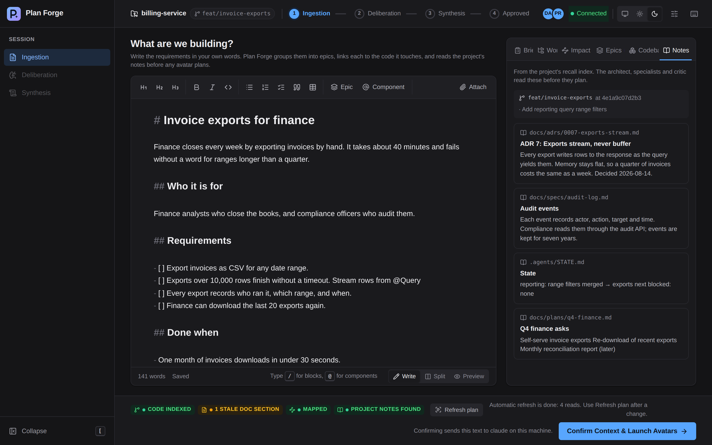
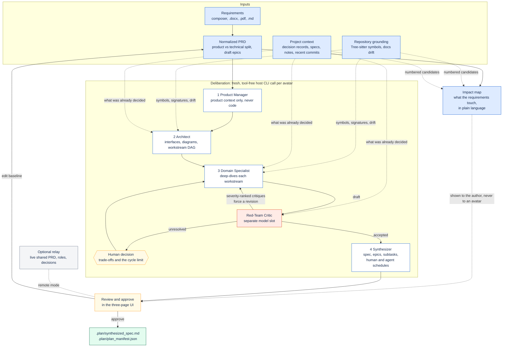

#  Agentic Plan Forge

[](https://github.com/danielckv/agentic-plan-forge/actions/workflows/ci.yml)
[](LICENSE)
[](https://github.com/danielckv/agentic-plan-forge/releases/latest)

**A blocking pre-planning gate for coding agents.** Instead of letting an agent jump from a brief straight to a linear
plan, Plan Forge deliberates first. You write what you want in a Markdown composer. Plan Forge reads the repository's
real code and the decisions your team already wrote down, runs a staged review by four avatars, and returns a verified
specification that the agent then executes.

It ships as one Go binary with an embedded web UI, plus an optional relay server for team planning sessions.



## Quickstart

```sh
curl -fsSL https://github.com/danielckv/agentic-plan-forge/releases/latest/download/install.sh | sh
```

Restart your agent, then type `/plan-forge`. Windows, manual installs and the full host matrix are in
[docs/install.md](docs/install.md).

You need Git, a browser, and Claude Code or OMP signed in. The planning window opens as a tab in your default browser
when you run `/plan-forge`, and only then. Plan Forge never asks for or stores provider API keys: it uses the credentials
your host agent already has.

### Update, reinstall and remove

There is no separate update command and nothing to force: the install command replaces the binary in place and
re-registers every skill and hook with the new path, whether or not one is already there.

```sh
# Update, or reinstall the same version over itself
curl -fsSL https://github.com/danielckv/agentic-plan-forge/releases/latest/download/install.sh | sh

# Install one exact release, to test a build or to roll back
curl -fsSL https://github.com/danielckv/agentic-plan-forge/releases/latest/download/install.sh | PLAN_FORGE_VERSION=v0.4.0 sh

# Re-register skills and hooks without downloading anything
plan-forge install

# Overwrite a skill or settings file you edited yourself (see below)
plan-forge install --force

# Remove what Plan Forge installed, restoring any settings file it changed
plan-forge uninstall --host all

# ...and delete its own config, credentials, backups and caches too
plan-forge uninstall --host all --purge
```

Two things that look like a failed update but are not:

- **A planning session already open keeps the old build.** Replacing the binary does not change a running process.
  Approve or close the tab, then run `/plan-forge` again.
- **`plan-forge install` exits 5 and leaves a file alone** when its contents no longer match what Plan Forge wrote,
  which means you edited it. That is deliberate — it will not throw away your edit. `--force` overwrites it. The other
  exit codes are 3 (no supported agent found) and 4 (you declined the prompt).

If a new build seems to have no effect, check `which -a plan-forge`: an older copy earlier on `PATH` shadows the one in
`~/.local/bin`. Uninstalling never touches a repository's `.plan/` folder, so approved plans and caches survive.

## A look inside

**Write the requirements.** One large editor with headings, checklists and tables. Type `/` for blocks such as an epic
or a diagram, and `@` to use the exact name of a component in your code. On the right, the requirements become epic files
as you write, each linked to the code it touches.

**See what it touches, before anything runs.** The Impact tab names the parts of your project this work affects and what
happens to each — changes, new, already there, or clashes with a decision the team already recorded — one sentence each,
in language that does not assume you read code. It is cached and recomputed only when the requirements, the code or the
project's notes change.



| Open an epic as a document | Browse the codebase while you write |
| :---: | :---: |
|  |  |

**Watch the avatars plan.** After you confirm, the Product Manager, Technical Architect, Red-Team Critic and Lead
Synthesizer work in the open: every status, draft, finding and decision lands in one discussion, and the plan takes shape
beside it.



| Review the specification | Light or dark |
| :---: | :---: |
|  |  |

The screenshots come from the UI driving a seeded sample session (`web/scripts/promo.mjs`), not from a live model run.

## Why

Agent plans often fail before implementation starts. A single-pass planner converges on the first plausible design,
trusts documentation that no longer matches the code, forgets what the team decided last month, and mixes product
requirements with low-level technical constraints. Plan Forge inserts a deliberation step that is slower and more
sceptical on purpose:

- Requirements are separated from technical constraints, so product decisions are not made by code-level accident. The
  impact map on the first page is derived from the interpreted requirements, never fed back into them, and the Product
  Manager never sees it.
- Proposals are grounded in the repository's real structure, and documentation drift is reported instead of trusted.
- The avatars read the team's decision records, specs and notes, so a plan builds on earlier decisions instead of
  reopening them.
- Drafts are attacked by a dedicated critic that runs on a different model slot than the authors.
- The result is a contract-verified specification with explicit targets, verification commands and effort estimates.

## How it works



Each avatar runs as a fresh, tool-free model invocation through the host agent CLI you already have installed and
authenticated. The Product Manager receives product requirements only: no file trees, no symbol graphs, no code, no
project notes. The Red-Team Critic runs on a separate model slot so it does not simply agree with its own drafting.

Repository grounding is deterministic. Files are parsed with Tree-sitter and reduced to exported symbols, signatures and
route registrations; documentation is cross-referenced against that graph so stale references become explicit
documentation-sync tasks instead of silent assumptions. Parse coverage gaps are reported as gaps, and structural matches
are never treated as proof that behaviour is complete.

Effort is estimated twice from the same task graph: a human schedule based on a 9-hour productive day, and an agent
schedule based on declared parallelism. Estimates are labelled as estimates unless they come from recorded runs.

### What it reads before planning

Before the avatars start, Plan Forge collects what the repository already says about the work, matched against your
requirements. It reads, read-only and without a model call:

1. A project-memory recall index, when one exists: the SQLite full-text index the [`agents`](docs/adrs/0002-read-agents-recall-index.md) workflow keeps at `<git-common-dir>/agents-local/recall.db`, or the older `.agents/index/recall.db`.
2. Otherwise the same files directly: `.agents/STATE.md`, `.agents/lanes/`, `.agents/sessions/`, `docs/specs/`, `docs/plans/`, `docs/adrs/` and `specs/`.
3. The branch, `HEAD` and recent commit subjects.

At most 12 excerpts and 64 KiB, with machine paths rewritten. The Notes tab on the first page shows exactly what the
avatars will read, and `plan-forge context --query "<topic>"` prints it in your terminal. None of these files is required:
without them the plan is grounded in the code alone.

The Impact tab goes one step further and asks the model which of those parts the requirements actually affect. It is
shown a numbered shortlist of declarations and excerpts and answers with their numbers, so every file it names exists.
The result is advisory: it is shown to you, cached in `docs/plans/.plan/cache/`, and never given to the avatars, who read
the code and the decisions for themselves. See [ADR 0005](docs/adrs/0005-prd-impact-map.md).

## Documentation

| Guide | What it covers |
| :--- | :--- |
| [Install](docs/install.md) | Requirements, one-command and manual install, what gets written per host, hooks, update and uninstall |
| [Usage](docs/usage.md) | The composer, the avatar room, the specification, Plan Mode handoff, `plan-forge validate` and `context` |
| [Configuration](docs/configuration.md) | Hosts, models, workday baseline and self-hosting the relay |
| [Decision records](docs/adrs/) | Why the live task views were removed, how project context is read, why the text is not scanned, how the impact map is built |
| [Requirements catalogue](docs/requirements/) | Owners, acceptance criteria and traceability for every requirement |
| [Contributing](CONTRIBUTING.md) | Development workflow and the full local check suite |

## Privacy and security

- Requirements documents, repository contents, project notes and absolute paths stay on your machine unless you
  explicitly start a remote session. The relay receives session state: the shared document, avatar summaries and drafts,
  critiques, decisions and the approved plan.
- Plan Forge does not scan, redact or block what you write. Your text goes to your own agent CLI, exactly as it would in
  a chat with that agent. See [ADR 0003](docs/adrs/0003-no-text-scanning-in-composer.md).
- Avatar invocations are tool-free. Every generation runs with repository access, skills and MCP servers disabled, and a
  tripwire aborts a run if a tool call appears anyway.
- A relay never accepts requests from a browser, requires TLS off loopback, and stores only hashes of credentials.
- Security reports are welcome, and should not be filed as public issues. See [SECURITY.md](SECURITY.md).

## Repository layout

```text
cmd/client, cmd/relay       entrypoints, separated by build tags
internal/contracts          shared data shapes, schemas and error codes
internal/ingestion          document parsing, PRD normalization and draft epics
internal/ast                Tree-sitter grounding and documentation drift
internal/gather             project context: recall index, notes and specs, Git state
internal/host               agent CLI adapters and skill installation
internal/avatars            staged deliberation and prompt contracts
internal/synthesizer        specification, manifest and effort schedules
internal/session, collab    authoritative state and shared-document editing
internal/relay              protocol, hub and local bridge
web                         embedded React UI
integrations                skill, command and hook templates
```

## Project status

Plan Forge is **pre-1.0**. Releases are published on
[GitHub Releases](https://github.com/danielckv/agentic-plan-forge/releases) with client archives for macOS, Linux and
Windows, relay archives for Linux, and a multi-architecture relay image at `ghcr.io/danielckv/plan-forge-relay`.
Interfaces can still change between minor versions; see [CHANGELOG.md](CHANGELOG.md).

Next on the roadmap: signing and notarisation for macOS and Windows builds, and Antigravity as a generation host once
its CLI exposes an isolated-settings selector.

## Contributing

Contributions are welcome. Please read [CONTRIBUTING.md](CONTRIBUTING.md) for the development workflow, local checks and
pull request expectations. This project follows the
[Contributor Covenant Code of Conduct](CODE_OF_CONDUCT.md). For help, see [SUPPORT.md](SUPPORT.md).

## License

Licensed under the [Apache License, Version 2.0](LICENSE).

Copyright 2026 Daniel Chernenkov
