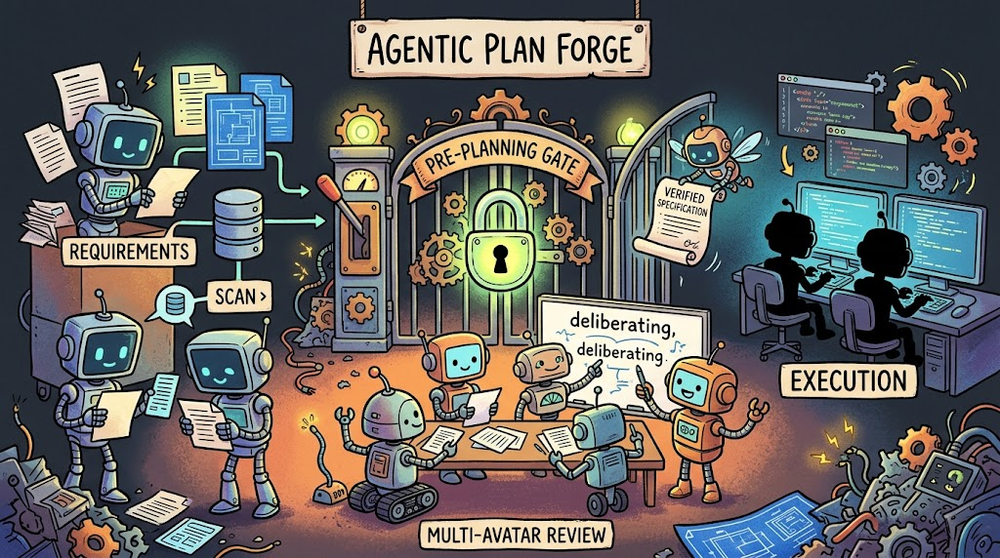
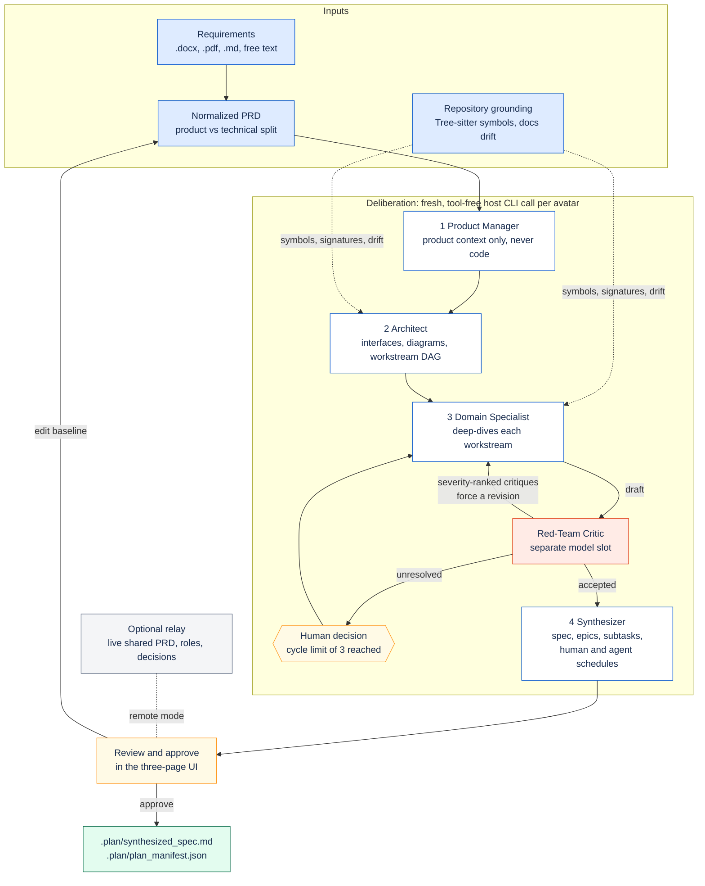

#  Agentic Plan Forge

[](https://github.com/danielckv/agentic-plan-forge/actions/workflows/ci.yml)
[](LICENSE)
[](https://github.com/danielckv/agentic-plan-forge/releases/latest)

**A blocking pre-planning gate for coding agents.** Instead of letting an agent jump from a brief straight to a linear
plan, Plan Forge deliberates first: it reads your requirements documents, scans the repository's actual symbols, runs a
staged multi-avatar review, and returns a verified specification that the agent then executes.

It ships as one Go binary with an embedded web UI, plus an optional relay server for team planning sessions.



## Quickstart

```sh
curl -fsSL https://github.com/danielckv/agentic-plan-forge/releases/latest/download/install.sh | sh
```

Restart your agent, then type `/plan-forge`. Windows, manual installs and the full host matrix are in
[docs/install.md](docs/install.md).

You need Git, a browser, and Claude Code or OMP signed in. The UI opens as a tab in your default browser. Plan Forge
never asks for or stores provider API keys — it uses the credentials your host agent already has.

## Why

Agent plans often fail before implementation starts. A single-pass planner converges on the first plausible design,
trusts documentation that no longer matches the code, and mixes product requirements together with low-level technical
constraints. Plan Forge inserts a deliberation step that is deliberately slower and more sceptical:

- Requirements are separated from technical constraints, so product decisions are not made by code-level accident.
- Proposals are grounded in the repository's real structure, and documentation drift is reported instead of trusted.
- Drafts are attacked by a dedicated critic that runs on a different model slot than the authors.
- The result is a contract-verified specification with explicit targets, verification commands and effort estimates.

## How it works



Each avatar runs as a fresh, tool-free model invocation through the host agent CLI you already have installed and
authenticated. The Product Manager receives product requirements only: no file trees, no symbol graphs, no code. The
Red-Team Critic runs on a separate model slot so it does not simply agree with its own drafting.

Repository grounding is deterministic. Files are parsed with Tree-sitter and reduced to exported symbols, signatures and
route registrations; documentation is cross-referenced against that graph so stale references become explicit
documentation-sync tasks instead of silent assumptions. Parse coverage gaps are reported as gaps, and structural matches
are never treated as proof that behaviour is complete.

Effort is estimated twice from the same task graph: a human schedule based on a 9-hour productive day, and an agent
schedule based on declared parallelism. Estimates are labelled as estimates unless they come from recorded runs.

## Documentation

| Guide | What it covers |
| :--- | :--- |
| [Install](docs/install.md) | Requirements, one-command and manual install, what gets written per host, hooks, update and uninstall |
| [Usage](docs/usage.md) | The three views, Plan Mode handoff, `plan-forge validate`, solo and remote sessions |
| [Configuration](docs/configuration.md) | Hosts, models, workday baseline and self-hosting the relay |
| [Requirements catalogue](docs/requirements/) | Owners, acceptance criteria and traceability for every requirement |
| [Contributing](CONTRIBUTING.md) | Development workflow and the full local check suite |

## Privacy and security

- Requirements documents, repository contents and absolute paths stay on your machine unless you explicitly start a
  remote session. The relay receives session state: the shared document, avatar summaries and drafts, critiques,
  decisions and the approved plan.
- Avatar invocations are tool-free. Every generation runs with repository access, skills and MCP servers disabled, and a
  tripwire aborts a run if a tool call appears anyway.
- A relay never accepts requests from a browser, requires TLS off loopback, and stores only hashes of credentials.
- Security reports are welcome, and should not be filed as public issues. See [SECURITY.md](SECURITY.md).

## Repository layout

```text
cmd/client, cmd/relay       entrypoints, separated by build tags
internal/contracts          shared data shapes, schemas and error codes
internal/ingestion          document parsing and PRD normalization
internal/ast                Tree-sitter grounding and documentation drift
internal/host               agent CLI adapters and skill installation
internal/avatars            staged deliberation and prompt contracts
internal/synthesizer        specification, manifest and effort schedules
internal/session, collab    authoritative state and shared-document editing
internal/relay              protocol, hub and local bridge
web                         embedded React UI
integrations                skill, command and hook templates
```

## Project status

Plan Forge is **pre-1.0**. Releases are published on
[GitHub Releases](https://github.com/danielckv/agentic-plan-forge/releases) with client archives for macOS, Linux and
Windows, relay archives for Linux, and a multi-architecture relay image at `ghcr.io/danielckv/plan-forge-relay`.
Interfaces can still change between minor versions; see [CHANGELOG.md](CHANGELOG.md).

Next on the roadmap: signing and notarisation for macOS and Windows builds, and Antigravity as a generation host once
its CLI exposes an isolated-settings selector.

## Contributing

Contributions are welcome. Please read [CONTRIBUTING.md](CONTRIBUTING.md) for the development workflow, local checks and
pull request expectations. This project follows the
[Contributor Covenant Code of Conduct](CODE_OF_CONDUCT.md). For help, see [SUPPORT.md](SUPPORT.md).

## License

Licensed under the [Apache License, Version 2.0](LICENSE).

Copyright 2026 Daniel Chernenkov
