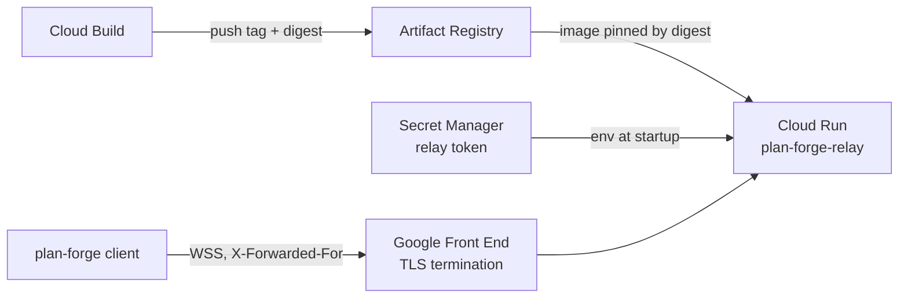

# Deploy the relay to Cloud Run

`plan-forge-relay` is a long-lived WebSocket hub that holds rooms in memory, so it deploys as a Cloud Run **service** —
not a Cloud Run function. `scripts/deploy-relay-cloudrun.sh` performs the full setup: APIs, Artifact Registry
repository, a Cloud Build image build, a Secret Manager token, a dedicated service account, and the Cloud Run deploy.



## Prerequisites

- `gcloud` CLI, authenticated (`gcloud auth login`, `gcloud auth application-default login`).
- A Google Cloud project with billing enabled.
- The deployer identity needs these roles (or equivalent): Run Admin, Artifact Registry Admin, Cloud Build Editor,
  Secret Manager Admin, Service Account Admin, and Service Usage Admin (plus Project IAM to bind roles).

## Quick start

```sh
./scripts/deploy-relay-cloudrun.sh --project my-project
```

On an interactive terminal the script asks what to build from: the local working tree (it warns when the tree is
dirty), a git tag or branch (it lists the latest 10 tags), or an existing image. It prints the build folder and ref,
then asks for confirmation; pass `--yes` to skip the prompt. For CI and other non-interactive use, pick the source
explicitly:

```sh
./scripts/deploy-relay-cloudrun.sh --project my-project --source ref:v0.1.0 --yes
```

The script prints the service URL when the deploy finishes.

## Flags

| Flag | Default | Purpose |
| --- | --- | --- |
| `--project ID` | `gcloud` config project | Target project. |
| `--region REGION` | `us-central1` | Cloud Run and Artifact Registry region. |
| `--service NAME` | `plan-forge-relay` | Cloud Run service name. Also the service account id, so it must be 6–30 characters. |
| `--repository NAME` | `plan-forge` | Artifact Registry Docker repository name. |
| `--source MODE` | interactive menu; `local` otherwise (and with `--dry-run`) | Build source. `local` uploads the repository root (resolved from the script location, not the cwd) to Cloud Build. `ref:<git-ref>` exports the ref with `git archive` into a temp folder and builds from it — reproducible, ignores uncommitted changes; the image version defaults to the ref. `image:<REF>` deploys an existing Artifact Registry image with no build. |
| `--image REF` | build from source | Alias for `--source image:REF`; mutually exclusive with `--source`. Cloud Run cannot pull `ghcr.io/danielckv/plan-forge-relay` directly; use an Artifact Registry remote repository proxying GHCR, or let the script build. |
| `--secret NAME` | `plan-forge-relay-token` | Secret Manager secret holding the relay token. |
| `--rotate-token` | off | Add a new random secret version and redeploy. |
| `--min-instances N` | `0` | Minimum instances. Set to `1` to keep rooms warm (always-on cost). |
| `--memory SIZE` | `512Mi` | Memory per instance. |
| `--cpu N` | `1` | vCPUs per instance. |
| `--version V` | ref name for `ref:...`, else `git describe --tags --always --dirty`, else `dev` | Image tag and the `VERSION` build arg. |
| `-y`, `--yes` | off | Skip the confirmation prompt before building. |
| `--dry-run` | off | Print every `gcloud` command, prefixed with a plus sign, instead of running mutating ones; read-only lookups still run. |
| `-h`, `--help` | - | Show help. |

## What gets created

1. Enabled APIs: Cloud Run, Artifact Registry, Cloud Build, Secret Manager.
2. An Artifact Registry repository for the image.
3. An image built by Cloud Build from `Dockerfile.relay` via `deploy/cloudrun/cloudbuild.yaml` — no local Docker
    needed. The script verifies the build folder contains `Dockerfile.relay`, `go.mod` and `cmd/relay/` before
    uploading. Cloud Build pushes `<region>-docker.pkg.dev/<project>/<repository>/<service>:<version>`; the script then
    resolves the digest and deploys Cloud Run with the image pinned by digest (`...@sha256:...`), so the service always
    runs exactly what was just built.
4. A Secret Manager secret containing a random 32-byte token. The token never appears on the command line and is never
    echoed.
5. A dedicated service account with `secretAccessor` on that secret only.
6. A Cloud Run service with:
    - port 8080 (the relay honors `PORT`),
    - `--behind-proxy --trusted-proxy=169.254.0.0/16` — Cloud Run terminates TLS; the GFE peer is link-local and appends
      the client IP to `X-Forwarded-For`, which the relay uses for rate limiting,
    - `PLAN_FORGE_RELAY_TOKEN` injected from the secret,
    - `--max-instances 1` (rooms live in memory; one instance holds them all),
    - `--concurrency 1000`, `--timeout 3600` for long-lived WebSockets (clients reconnect after the cut),
    - `--no-cpu-throttling`,
    - `--allow-unauthenticated` — the relay enforces its own token for session creation and invite codes for joining,
      and rejects browser origins.

## Client setup

Only the host machine needs the token:

```sh
plan-forge config --relay-url https://<service>-<hash>.<region>.run.app
gcloud secrets versions access latest --secret plan-forge-relay-token --project <id>
plan-forge config --set-relay-token   # paste at the hidden prompt
```

Alternatively, export `PLAN_FORGE_RELAY_TOKEN` in the host shell. Teammates join with `plan-forge join` and the invite
shown in the host window; they never need the token.

## Operations

```sh
# Health check — expect: ok
curl https://<url>/healthz

# Logs
gcloud run services logs read plan-forge-relay --region us-central1

# Rotate the token and roll the service
./scripts/deploy-relay-cloudrun.sh --project <id> --rotate-token

# Teardown
gcloud run services delete plan-forge-relay --region us-central1
gcloud secrets delete plan-forge-relay-token
gcloud artifacts repositories delete plan-forge --location us-central1
gcloud iam service-accounts delete <sa-email>
```

## Limitations

- Scale-to-zero or a redeploy drops rooms. The owner's local state reseeds the room on reconnect. Set
  `--min-instances 1` to keep rooms warm, at the cost of an always-on instance.
- Behind an external HTTPS load balancer, the rightmost `X-Forwarded-For` entry is the load balancer, so rate limits
  key per load balancer rather than per client.
- The org policy "Domain restricted sharing" can block `--allow-unauthenticated`; if so, restrict invokers and
  distribute the relay through IAM instead.
