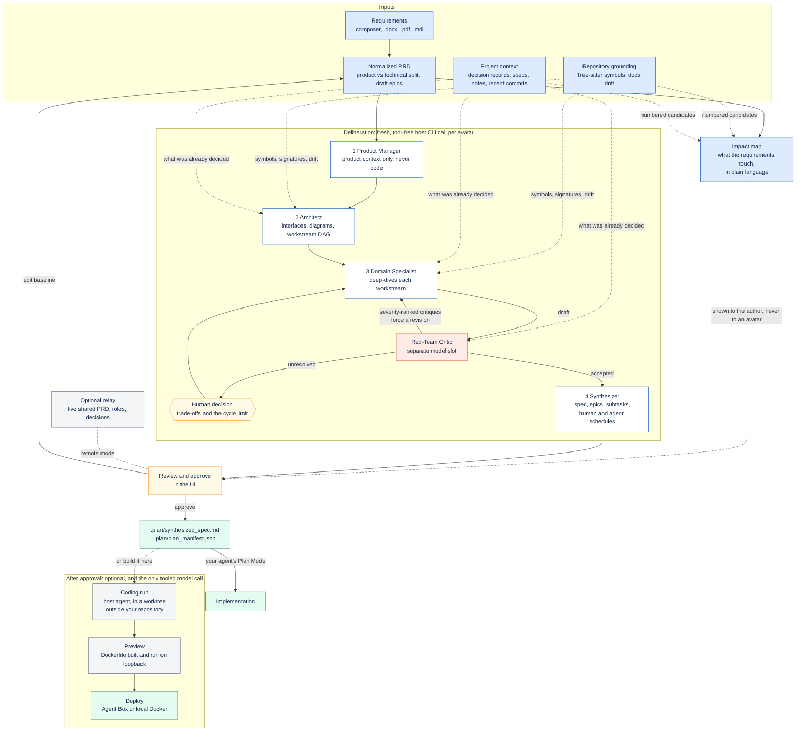

# Using Plan Forge

Type `/plan-forge` in your agent. Before it opens anything, the skill reads what the repository already says about your
request (`plan-forge context`, below) and asks a few questions to agree a short brief. It then opens a tab in your
default browser and waits, so the agent's terminal stays blocked until you approve a plan. Closing the tab without
approving ends the session.

## How a plan is made



The avatars are tool-free by contract: no repository access, no skills, no MCP servers. The coding run after an
approval is the single exception, and it is confined to a git worktree under the Plan Forge cache — never your working
tree, and never a remote.

## The pages

The window has three pages in order, and a fourth once a plan is approved. The top bar shows the project, its branch, the phase, who is here, the
connection, a System/Light/Dark switch and the shortcut sheet (`?`). The sidebar collapses with `[`.

### 1. Ingestion: the composer

The **Brief** tab on the right lists the five topics the deliberation will ask about — who it is for,
what done looks like, why now, what is out of scope, and what already exists — and ticks each one your
document mentions. **Add** inserts the section heading for one it does not. It is an outline, not a
gate: Confirm stays live whatever it says, and the check is a word search over your own text, so a tick
means the topic is mentioned, not that it is answered.

Write what you want to build in the editor. It is one shared Markdown document; collaborators in a remote session see
each other's edits live.

- **Formatting.** The toolbar sets headings, bold, italic, inline code, lists, checklists, quotes and tables. `⌘B`, `⌘I`
  and `⌘E` work too, and Enter continues a list.
- **Blocks.** Type `/` at the start of a line for a heading, an epic section, a user story, a checklist, a table, a code
  block or a Mermaid diagram.
- **Components.** Type `@` to search the repository's public declarations, such as functions, types and routes. Choosing
  one writes its exact name as inline code. A bare `@` lists the blocks (directories). Technical names go to the
  technical appendix, which the architect reads and the Product Manager never sees.
- **Files.** Attach `.docx`, `.pdf` or `.md` files from the toolbar, or drop them on the editor: up to 5 files, 25 MiB
  each. They are parsed on this machine and added as a `## Source:` section.
- **Write, Split, Preview.** The switch under the editor shows the rendered document beside or instead of the source.

The right rail shows the plan as it forms:

- **Impact.** Which parts of your project this work touches, in plain language, so you do not have to read code to know
  what will change. See below.
- **Epics.** A few seconds after you stop typing, the interpretation groups your requirements into epics. Each shows as a
  file such as `e1-csv-invoice-export.md`, with its requirements, acceptance criteria and what it touches. Click one to
  read it as a document or copy its Markdown.
- **Codebase.** The repository's blocks and their public declarations, with search. Click a name to write it into the
  requirements.
- **Notes.** The project context the technical avatars will read (see below).

The footer shows whether the code is indexed, whether any documentation is stale, what the work touches and whether
related notes were found. **Confirm Context & Launch Avatars** freezes the document and starts the run. Plan Forge does
not scan or block what you write.

#### The Work tab

**Work** reads the repository's own planning files and shows what is next, which epics and tasks exist, and which
decision records apply. It reads `.agents/STATE.md`, everything under `docs/`, the top-level `plans/`, `specs/`,
`adrs/` and `decisions/` directories, and root files named like a plan, a follow-up, an epic, a task or a state file.

A plan nested a folder deeper is still found, so `docs/plans/q4/export.md` is a plan. Decision records are recognised
under `docs/adrs`, `docs/adr` and `docs/decisions`. Media directories such as `docs/images` are not walked. The next
list is exactly the order the active state file gives; everything else is shown by kind with the file and line it came
from.

Browsing is read-only. It starts no model call and changes no file. **Use in brief** inserts the source path and line
into your requirements, so the plan can say where a requirement came from. A project that keeps its plans elsewhere
can name extra directories with `repository_work_roots`.

#### When the plan refreshes itself

Writing a brief does not require a button press: the plan rail and the impact map follow the document on their own, four times.

- Nothing is read until the brief passes **100 words**. Below that you are still sketching, and an interpretation would describe text you are about to replace.
- After that a re-read happens after **30**, then **60**, then **120** more words. It waits until you stop typing. Four reads carry a brief to 310 words.
- Then the automatic path stops. **Refresh plan** in the footer re-reads the document once, immediately.

Pressing **Refresh plan** also switches the automatic path off for the session, and the note beside the button says so. Two mechanisms reading one document would bill twice and race each other. A press means you control when it happens. The button keeps working afterwards.

#### Questions about the brief

When a sentence in the brief is genuinely unclear, the normalizer raises it as a classification question rather than
guessing. Each one shows the question, the sentence it came from, and three answers: it changes **what** we build, it
changes **how** we build it, or it is **not** a real ambiguity. Only the session owner can answer, and only while the
brief is still being read. Answering applies in memory: it makes no new model call.

#### What this touches

Each epic names the parts of your project it affects, and says what happens to each:

| | |
| :--- | :--- |
| **Changes** | This part exists and the work modifies it. |
| **New** | Nothing in the project does this yet. |
| **Already there** | This part already does the job and is used unchanged. |
| **Clashes** | The requirement contradicts a decision or specification the team already recorded. The contradicted document is named, with what it says. |
| **Possibly involved** | A name match only, shown while the full read is still running. It claims nothing more. |

The panel paints immediately with deterministic name matches as you edit or resolve ambiguity chips, without making a
model call. Clicking **Re-interpret** runs the model pass over your repository's code, documentation and decision
records and replaces the name matches with the list above. Every file it names exists: the model chooses
among declarations and excerpts it was shown, so it cannot invent a path. The map is advisory and is not given to the
avatars, who read the code and the decisions for themselves.

Raw normalization is cached by document text, so resolving ambiguity chips on Page 1 applies in memory with zero model
calls. Impact model results are cached in `docs/plans/.plan/cache/`, which is not committed. Without a signed-in agent
CLI the name matches are all you get, and the panel says so. See [ADR 0005](adrs/0005-prd-impact-map.md) and
[ADR 0016](adrs/0016-five-minute-deliberation-budget.md).

### 2. Deliberation: the avatar room

The four avatars sit across the top with what each is doing now. Click one to show only its lines.

- **Discussion.** Every status, draft, critic finding and decision in the order it happened. Decisions the avatars cannot
  make wait at the top as A/B cards; synthesis waits until you choose.
- **Plan taking shape.** The Product Manager's epics as files, the architect's diagram and workstreams, the critic's
  findings by severity, and **Usage**: how many calls each generation host served, the tokens it reported and how long
  it took, per host and per avatar.

**Synthesize Master Spec** unlocks once every avatar has finished the cycle, no CRITICAL or HIGH finding is open and no
decision waits. A run that reaches the cycle limit with blocking findings pauses and offers to retry the architect or
revise the requirements.

**When a stage fails.** The room says which stage failed and offers **Retry stage** and **Revise baseline**. The avatars
that never ran are marked cancelled rather than left waiting. Retrying re-runs only the failed stage: every draft that
was already validated is kept. The button reads **Retrying…** until the board moves, and a second click is refused
rather than cancelling the call the first one started.

A draft is failed for what it got wrong, never for what the payload already decided. A Domain Specialist plans one
workstream, so a task of its draft that leaves `workstream_id` empty inherits the draft's; a task that names a
*different* workstream is still rejected, because that is a disagreement rather than an omitted field. Similarly, a
specialist contract claim that quotes the architect's exact `version_hash` and leaves a schema field blank or restates
the contract signature alongside the schema is aligned to the architect's contract without opening a decision card,
while genuine schema alternatives still wait for your choice.

**How the architect runs.** The stage answers in three parts: the design (up to 4 cohesive workstreams and interface
contracts), the diagrams drawn from it, and the documentation tasks in batches of at most 20 stale documents. Each part
is kept on its own, so a retry re-runs only the part that failed.

The specialists wait for the design part and for nothing else. The diagrams and the documentation batches run beside
them, not before them, so a repository with a lot of stale documentation no longer holds the specialists up: measured on
this repository, the architect spent 43m46s across 15 calls, 13 of them documentation batches, and every one of those 13
used to block the stage. One limit covers the whole cycle, so the architect's remaining parts and the specialists
together never exceed the configured `max_parallel` (default 4).

A call that outruns its budget — `stage_timeout_seconds`, 600 seconds by default — is not repeated unchanged: it runs
again with half its evidence, and says in the payload what it gave up. See
[ADR 0007](adrs/0007-the-architect-answers-in-parts.md),
[ADR 0009](adrs/0009-one-budget-per-stage-roles-across-hosts-and-a-live-room.md),
[ADR 0011](adrs/0011-the-documentation-batches-leave-the-critical-path.md) and
[ADR 0016](adrs/0016-five-minute-deliberation-budget.md).

**When you come back.** An unfinished run is kept in `docs/plans/.plan/run.json`, so closing the window or losing the
process does not throw away work a model was already paid for. The next run over the same requirements picks the drafts
up and puts the epics and the architecture straight back on the board; only the stages that never finished run again.
Change the requirements, the code or the configured models and the saved drafts no longer match — the page says so and
the run starts over. Approving a plan deletes the file.

**What the avatars are given.** Each technical stage receives a bounded view of the repository: the code graph (200 KiB),
the project notes (64 KiB) and the documentation drift list (128 KiB **and at most 60 items**, confirmed drift first,
then what your stories are about). The item limit matters as much as the size one: the architect writes one
documentation task per confirmed item, so an unbounded list is both a longer run and a specification carrying hundreds
of documentation chores. A specialist is given its own workstream's code rather than the whole repository — the module
paths the architect assigned it come first, inside a 64 KiB budget — because specialists run at the same time and a
graph that is mostly irrelevant is paid for in every one of those calls at once.

Each part of a stage receives only what it answers: the architect's design part gets no drift, its documentation part
gets no code graph. When a stage input still does not fit its limit, or the call outruns the clock, evidence is given up
in that order and the payload says what was cut, so the model treats the gap as unchecked rather than as nothing to do.

### 3. Synthesis: the specification

A Confluence-style specification with diagrams, Jira-style epics and subtasks, documentation-sync tasks and the two
effort schedules. The table of contents follows your scroll. The task matrix can be filtered by ID, title or target
file. Diagrams expand to full screen.

## Setup: what this installation can do

The sliders button in the top bar opens **Setup**: every generation host with whether it can actually
serve a call, the external tools each feature needs, the skills installed into each agent, and the
managed hooks.

The distinction worth knowing is **signed in** versus **serving**. A host can be installed,
authenticated and still unable to take a call — Antigravity is exactly this case. Setup shows the
host's own refusal text, and says so explicitly when a configured `main_host` or `judge_host` is being
ignored because of it. The same facts are on the terminal in `plan-forge doctor`.

On first use, Setup also lists the coding agents it found installed: Claude Code, oh-my-pi, agy, Codex,
pi, OpenCode, Gemini and Cursor Agent. Presence is not capability. A tool Plan Forge has no adapter for
is reported as detected and **not usable**, with a line saying so, because reporting it as available
would repeat the "signed in but cannot serve" confusion above. The scan only checks `PATH`; it runs
nothing.

## Project context

Before planning, Plan Forge collects excerpts from the project's own notes, specs, plans and decision records that match
the requirements, plus the branch, `HEAD` and recent commit subjects. The Architect, Specialists and Critic receive them;
the Product Manager does not. Sources, in order:

1. The recall index at `<git-common-dir>/agents-local/recall.db`, rows for this working tree only.
2. The older index at `.agents/index/recall.db`.
3. The files those indexes cover: `.agents/STATE.md`, `.agents/lanes/`, `.agents/sessions/`, `docs/specs/`, `docs/plans/`, `docs/adrs/` and `specs/`.

Everything is read-only, bounded to 12 excerpts and 64 KiB, and repository-relative. Print the same context yourself:

```sh
plan-forge context --query "invoice exports"          # Markdown
plan-forge context --query "invoice exports" --json   # for scripts
```

[ADR 0002](adrs/0002-read-agents-recall-index.md) records the design.

### 4. Build: code, preview, deploy

Once a plan is approved, the window offers to build it. **Write the code** opens an isolated worktree under the Plan
Forge cache, on a `plan-forge/<approval-id>` branch, and hands the approved spec to your host agent inside it. Nothing
is written to the repository you are working in, and nothing is pushed: you merge the branch yourself.

Two tabs answer the same question from two sides:

- **Code** lists the changed files with their line counts, shows the full diff, opens any single file, and logs what
  the agent did step by step.
- **Preview** builds the worktree's root `Dockerfile` and runs it on `127.0.0.1`, framed in the page. The frame is
  sandboxed, so code the agent wrote minutes ago cannot reach the window around it.

**Deploy** publishes that same image, to an Agent Box sandbox or to your local Docker daemon. The first time, the
window asks which; after that it is a toggle on the page and a `deploy_target` key in the config. Choosing
**Don't deploy** keeps the original behaviour, where the tab closes shortly after an approval.

**Discard worktree** removes the worktree, its branch and the preview container. **Finish** ends the session and
leaves everything in place.

#### The Documents tab

An approved plan can be written into your repository as files: a plan with its ordered tasks, a specification with
acceptance criteria, and one decision record for each decision the deliberation actually made. The **Documents** tab on
the Build page lists every path it would write before anything is written.

The button is the only thing that writes. A file that already exists stops the whole export before the first write, so a
generated document never replaces one you wrote and a refused export leaves your repository untouched. Decision records
are numbered after the highest number your `docs/adrs` already uses, so history is never renumbered. Pressing the button
again after an interrupted export finishes the job instead of making a second copy.

This needs no sandbox, no provider key and no network: it is the path for a team that wants the planning deliverables
without renting a machine. See [ADR 0018](adrs/0018-documents-are-written-and-the-sandbox-gets-the-source.md).

### 5. Prepared VM: build, test and preview elsewhere

Approving a plan does not require a machine to stay on. The **Build** page carries a prepared-VM panel that builds and
tests a revision in a managed sandbox and serves a live preview you can click through. It is optional: with no sandbox
configured, everything above still works, and a plan, its specification, its decision records and its recorded commands
are still produced.

The commands come from the repository, not from a model at launch time. Plan Forge reads the project's own manifests,
lockfiles, CI configuration, `Makefile`, package scripts and containers, then records the build, test and run commands
it found in `execution_recipe.json` beside the approved plan. It reuses an existing command rather than wrapping it, and
it says **not configured** when a step has no command instead of reporting a pass. Review those commands before you
launch: the sandbox runs exactly them.

**The project travels with the launch.** Before the first command runs, Plan Forge packs your checkout into an archive
and uploads it to the sandbox: the source, the recorded scripts and the recipe. It leaves behind `.git`, dependency
directories, build output, host state and credential files, because a build needs none of them and a credential on a
rented VM is a leak you cannot see. Symlinks are never packed, since a link can point outside your checkout. The panel
says how many files went and how many were left out, so an exclusion is never silent. A project that needs a directory
the packager drops can name it as an include.

A launch asks you to confirm the revision, the commands, the resources, the expiry and the cost estimate. The default
lifetime is one hour, and the provider enforces it. **Stop** deletes the sandbox; if the deletion cannot be confirmed,
the page says so and the provider's expiry is the backstop. **Open preview** appears only once the sandbox has passed
its recorded readiness check, so a page that merely opened a port does not count as running.

Changing the revision, the scripts, a lockfile or the instructions the recipe cites invalidates earlier results: a
green preview can never outlive the code it described. Settings and the full reasoning:
[configuration.md](configuration.md#what-runs-the-build-and-where),
[ADR 0017](adrs/0017-prepared-vm-from-recorded-scripts.md) and
[ADR 0018](adrs/0018-documents-are-written-and-the-sandbox-gets-the-source.md).

**Accepting an implementation** is a separate decision from approving the plan. Both your own sign-off and a developer
review on GitHub must cover the same commit, and the review must come from someone with write access who is not the
author. A new commit, a dismissed review or a changed recipe takes the acceptance back. Plan Forge never merges the
pull request.

## Plan Mode handoff and validation

Approving writes the plan, and the tab shows each handoff step. It then says it is safe to close: the tab is yours, in
your own browser, so Plan Forge never closes it for you.

1. `plan-forge wait` returns the approval with a `validation` result. The validation checks that the plan is approved on
  this machine, that it has not drifted from the repository, and how many AST targets already exist.
2. The agent enters Plan Mode with the specification as the source of truth.
3. The agent reviews the validation, verifies the targets, and presents the execution checklist for your approval.

How each host enters Plan Mode:

- **Claude Code** calls `EnterPlanMode`, enforced by the managed `PostToolUse` hook.
- **OMP** `/plan-forge` opens a new plan-mode session seeded with the spec and the validation result. If the session API
  is unavailable, the hook prefills `/plan …` and you press Enter.
- **Antigravity** asks you to switch modes.

You can re-run the check at any time:

```sh
plan-forge validate            # exit 0 valid, 6 invalid
plan-forge validate --json
```

## Solo and remote

Solo mode keeps everything local. In remote mode, teammates install the client and join a session with an invite, and the
relay mirrors session state so everyone sees the same document, drafts and decisions. Only the host machine runs the
model pipeline, so a run is never billed twice. Approving a plan never stages, commits or pushes anything: your Git
history stays under your control.
