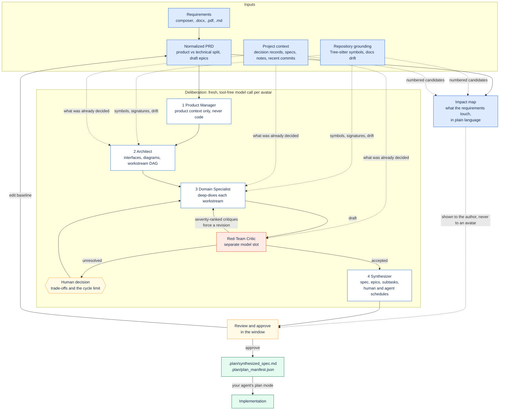

# Using Plan Forge

Type `/plan-forge` in your agent. It opens a tab in your browser and waits there until you approve a plan or close the
tab. You write what you want built in that tab, not in the chat.

## How a plan is made



The avatars are tool-free by contract: no repository access, no skills, no MCP servers. The optional coding run after
an approval is the single exception, and it stays in a worktree under the Plan Forge cache.

## The pages

**1. Ingestion.** Write the requirements, or drop in a `.docx`, `.pdf` or `.md`. The composer lists the five topics the
avatars will ask about and ticks the ones your text already covers — a word search, not a score. The Work tab shows
what the repository already says. The impact map names what the requirements touch, in plain language.

**2. Deliberation.** Each avatar card names the host and model serving it, the part of the stage in flight, how long
the call has run and what evidence it can see, refreshed every 10 seconds. Questions the avatars cannot settle open in
a drawer: each shows the context, the options, a recommendation and the tasks it affects. A recommendation is a hint,
never an answer.

**3. Specification.** The plan, its epics and subtasks, and a readiness verdict. A run always ends with a plan; if
blocking findings are still open, they are written onto it and named at the top.

**Setup.** What this installation can do: the hosts found, whether each is signed in, the models available, and the
skills on this machine. API keys are added here.

## Terminal instead of browser

```sh
plan-forge run --frontend terminal
```

The same session, drawn in the terminal over the same socket. Five panes, one key each: **1** brief, **2** agents,
**3** plan, **4** questions, **5** settings. `Tab` moves between panes, arrows move the selection, `Enter` acts, `?`
lists every key. On the questions pane `1`–`9` answer the selected question. On the brief pane `e` opens an editor:
every printable key is text, `Ctrl-S` appends, `Esc` cancels.

Colour is on when the output is a terminal. `NO_COLOR` or `TERM=dumb` turns it off.

Closing the terminal does not cancel the run.

## Project context

Before planning, Plan Forge collects excerpts from the project's own notes, specs, plans and decision records that
match the requirements, plus the branch, `HEAD` and recent commit subjects. The Architect, Specialists and Critic see
them; the Product Manager does not. Everything is read-only, bounded to 12 excerpts and 64 KiB.

```sh
plan-forge context --query "invoice exports"
plan-forge context --query "invoice exports" --json
```

## After approval

Approving writes `docs/plans/.plan/synthesized_spec.md` and a manifest, and `plan-forge wait` returns with a validation
result: that the plan was approved on this machine, that it has not drifted from the repository, and how many of its
file targets already exist. Your agent then enters plan mode with the spec as the source of truth, verifies the
targets, and presents the execution checklist for your approval.

Claude Code calls `EnterPlanMode` itself. oh-my-pi opens a new plan-mode session seeded with the spec, or prefills
`/plan …` for you to press Enter. Antigravity asks you to switch modes.

```sh
plan-forge validate          # exit 0 valid, 6 invalid
plan-forge summary           # the executive summary, in the terminal
plan-forge open              # the read-only plan view
```

The plan can also be built here: the **Code** tab runs the agent in a worktree, **Preview** builds and runs the root
`Dockerfile` on loopback, **Deploy** publishes that same image.

## Solo and remote

Solo keeps everything local. In remote mode teammates join with an invite and the relay mirrors the document, drafts
and decisions, but only the host machine runs the model pipeline, so a run is never billed twice. Approving never
stages, commits or pushes anything.
